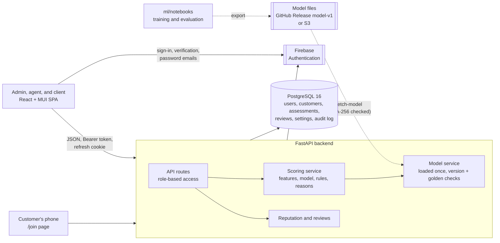

# SalesMesh

SalesMesh is a distributed sales-agent onboarding platform, built as a
final-year capstone project. Sales agents register customers through personal
referral links, and an AI engine checks every registration for signs of fake
customers. Administrators review flagged registrations and see a reputation
score from 0 to 100 for every agent; clients see the registration quality of
the agents who work for them.

## Features

- **Customer registration by referral link.** Each agent has a
  non-guessable referral code. Customers register on a mobile-first public page
  (`/join/<code>`) with a consent checkbox and privacy notice (Kenya Data
  Protection Act 2019). Agents can also register a customer on their own device
  (assisted mode). Referral links can be shared by copy, WhatsApp, SMS, email,
  or QR code.
- **Fraud detection.** A calibrated logistic regression, trained on the BAF
  dataset (NeurIPS 2022), scores every registration from 13 features. Numeric
  values are clipped to the training range, and a transparent rule flags a
  device that registers many different emails. Every flag comes with
  plain-English reasons labelled **Model** or **Rule**.
- **Human review.** Flagged registrations wait in a review queue; an admin
  confirms each as real or fake. The model never rejects anyone on its own.
- **Agent reputation.** A smoothed 0–100 reputation and risk score with bands
  (High risk, Watch, Low risk, Insufficient data), calculated on read, so it
  is always current. It is an admin-only decision-support tool: agents cannot
  see it, which stops them from gaming it.
- **Client dashboard.** Registrations, human-confirmed fakes, and a 12-month
  trend for the client's own agents. No model scores are shown to clients.
- **Model operations.** The API refuses to load the model with a different
  scikit-learn version and checks 20 golden examples at every start. The admin
  Model page shows metrics, the golden check, a safe reload, and monthly drift
  monitoring against the expected flag rate.
- **Privacy.** Admins can erase a customer's data on request; the erasure is
  audited without personal data. Agents and customers never see probabilities
  or reasons.
- **Secure authentication.** Firebase Authentication for sign-in (email and
  password, or Google), email verification, and password resets; SalesMesh
  keeps roles, agent approval, sessions, and the audit log. Admins confirm
  every sign-in with an authenticator app (TOTP) and have one-time recovery
  codes. Short-lived JWT access tokens, rotating refresh tokens in httpOnly
  cookies with reuse detection, rate limiting, role-based access control, and
  checks that refuse disposable or mail-less email addresses.
- **Automation.** One-command Docker Compose startup, demo data with a single
  command, pre-commit hooks, GitHub Actions CI, and Dependabot.

## Architecture



| Layer | Technology |
| --- | --- |
| Frontend | React 19, Vite, TypeScript, MUI, React Router, TanStack Query, axios, react-hook-form, zod, Recharts, qrcode.react, Firebase Auth SDK |
| Backend | FastAPI, pydantic-settings, SQLAlchemy 2.0, Alembic, firebase-admin, PyJWT, pyotp, cryptography, dnspython, phonenumbers |
| Machine learning | scikit-learn 1.7.2, pandas, numpy, joblib (training in Jupyter notebooks) |
| Database | PostgreSQL 16 (Docker) |
| Tooling | Docker Compose, Ruff, pytest, ESLint, Prettier, Vitest, pre-commit, GitHub Actions, Dependabot |

See [architecture](docs/architecture.md), [ML integration](docs/ml-integration.md),
and the [authentication overview](docs/authentication.md) for diagrams.

## Setup From a Clean Clone (Windows)

Run every command in **Windows PowerShell** from the repository root.

### 1. Prerequisites

| Tool | Version | Check |
| --- | --- | --- |
| Git | any recent | `git --version` |
| Docker Desktop (Linux containers, Compose v2) | any recent | `docker compose version` |
| Python | 3.14 | `python --version` |
| Node.js and npm (only for frontend checks on the host) | 22.13 or newer | `node --version` |

Start Docker Desktop and wait until it says the engine is running.

### 2. Clone

```powershell
git clone https://github.com/Myranyamwanda/Salesmesh.git
Set-Location Salesmesh
git switch develop
```

`develop` has the latest integrated work; `main` has the latest release.

Docker Compose names the project after the folder (`salesmesh`). If you
already have another SalesMesh clone in a folder with the same name on this
machine, both would share the same containers and database volume. Give the
second clone its own project name in every PowerShell window you use for it,
before any `dev.ps1` command:

```powershell
$env:COMPOSE_PROJECT_NAME = "salesmesh2"
```

Only one clone can run at a time, because both use the same ports.

### 3. Configure `.env`

```powershell
Copy-Item .env.example .env
notepad .env
```

In `.env`, set at least:

- `POSTGRES_PASSWORD`: a unique local password.
- `DEMO_PASSWORD`: the password for every demo account (12+ characters with
  upper and lower case, a number, and a symbol). In `.env.example` this line
  is commented out, so **remove the leading `#`** and replace the placeholder,
  for example `DEMO_PASSWORD=Demo-Salesmesh-2026!`.
- `POSTGRES_PORT`: if PostgreSQL is installed directly on Windows, it already
  uses port 5432, so set `POSTGRES_PORT=5433` (or another free port).
- **All six Firebase variables. They are required: sign-in does not work
  without them.** Create the Firebase project first by following
  [Firebase setup for a new developer](docs/authentication.md#firebase-setup-for-a-new-developer):

  | Variable | Value |
  | --- | --- |
  | `VITE_FIREBASE_API_KEY` | Web app `apiKey` |
  | `VITE_FIREBASE_AUTH_DOMAIN` | Web app `authDomain` |
  | `VITE_FIREBASE_PROJECT_ID` | Web app `projectId` |
  | `VITE_FIREBASE_APP_ID` | Web app `appId` |
  | `FIREBASE_PROJECT_ID` | The same Project ID (read by the backend) |
  | `FIREBASE_CREDENTIALS_PATH` | Path of the service-account key file, **outside the repository**, with forward slashes, for example `C:/Users/<you>/secrets/salesmesh-firebase-admin.json` |

  Keep the `VITE_` prefix on the first four: the browser receives only `VITE_*`
  variables. The key file is a secret; Docker mounts it read-only, so `.env`
  keeps the Windows path.

There is **no separate frontend `.env`**: the frontend reads the same root
`.env` (the four `VITE_FIREBASE_*` values, plus `VITE_API_URL` and
`VITE_PRIVACY_CONTACT_EMAIL`, which have working defaults). Every setting is
explained in `.env.example`. Never commit `.env` or the key file.

### 4. Backend tools and the secrets

```powershell
python -m venv backend/.venv
backend/.venv/Scripts/python.exe -m pip install -r backend/requirements-dev.txt
backend/.venv/Scripts/python.exe backend/manage.py init-secret
```

The `pip install` takes **about 6 minutes** the first time, because it
installs the ML packages (scikit-learn, numpy, pandas, scipy). `init-secret`
writes a random `JWT_SECRET` and a `TOTP_ENCRYPTION_KEY` (which encrypts the
admins' authenticator secrets) into `.env` without printing them, and leaves
existing values unchanged.

### 5. Model files

```powershell
.\scripts\dev.ps1 fetch-model
```

This downloads `model.joblib`, `metadata.json`, `golden_examples.json`, and
`coefficients.json` from the GitHub Release
[`model-v1`](https://github.com/Myranyamwanda/Salesmesh/releases/tag/model-v1)
into `backend/models/v1/` and keeps a file only if its SHA-256 matches
`ml/model_contract/model-v1.sha256`. Model files are never committed. The
alternative source is S3 (`MODEL_SOURCE=s3`, see
[ML model service](docs/ml-scoring.md#getting-the-model-files)).

### 6. Start the stack and apply migrations

```powershell
.\scripts\dev.ps1 up
.\scripts\dev.ps1 migrate
Invoke-RestMethod http://localhost:8000/health
```

`up` builds and starts PostgreSQL, the API, and the frontend, waits for their
health checks, and applies migrations; `migrate` is safe to run again. The
health check must show `"database": "ok"` and `"model": "ok"`.

**The first `up` can take 10–30 minutes**, depending on the internet
connection, because the backend image installs the large ML packages
(scikit-learn, numpy, pandas). In the clean-clone check it took about 9 and 23
minutes. Later starts use Docker's build cache and are much faster.

- Frontend: <http://localhost:5173>
- API documentation: <http://localhost:8000/docs>

### 7. First admin

Use an address that can receive email; a Gmail plus-address such as
`you+admin@gmail.com` works.

```powershell
.\scripts\dev.ps1 create-admin -Email you+admin@gmail.com
```

The command creates the admin in SalesMesh and Firebase and prints a one-time
link. Open it to set the password (12+ characters with upper and lower case,
a number, and a symbol), and do not share it. Then sign in at
<http://localhost:5173> with that email and password: the first sign-in asks
you to scan a QR code with an authenticator app and shows 10 recovery codes
once. Save them outside the repository. `create-admin` also works when other
admins exist. A plus-address admin signs in with email and password, not
Google (see [Authentication](docs/authentication.md#replacing-an-admin-whose-email-cannot-receive-mail)).

### 8. Demo data

```powershell
.\scripts\dev.ps1 seed-demo
```

This takes about two minutes. It creates a demo admin, 3 clients, and 40
agents (4 of them fraudulent) with about 3,300 customers scored by the real
model, creates the 44 demo users in Firebase, and prints the logins. It also
prints the **demo admin's authenticator setup key once**: add it to your
authenticator app ("Enter a setup key") straight away. Running it again adds
nothing; `.\scripts\dev.ps1 reset-demo` removes only the demo data and the
demo Firebase accounts, never any other account.

| Role | Email | Password |
| --- | --- | --- |
| Admin | `admin@demo.example.com` | `DEMO_PASSWORD` from `.env`, plus the authenticator code |
| Agent (honest) | `agent01@demo.example.com` | same |
| Agent (fraudulent) | `agent04@demo.example.com` | same |
| Clients | `client1@demo.example.com`, `client2@…`, `client3@…` | same |

Demo emails use the reserved `example.com` domain and can never receive mail,
so demo accounts are created already verified and approved, in SalesMesh and
in Firebase.

### 9. Checks

```powershell
.\scripts\dev.ps1 test
.\scripts\dev.ps1 lint
Push-Location frontend
npm ci
npm test
npm run build
Pop-Location
```

`test` runs the backend tests in the API container against a separate
`salesmesh_test` database, never against development data. The first
`npm ci` takes a few minutes (about 3½ in the clean-clone check).

### 10. Git hooks (optional)

```powershell
backend/.venv/Scripts/python.exe -m pre_commit install
backend/.venv/Scripts/python.exe -m pre_commit run --all-files
```

The hooks run Ruff (not on the notebooks), Prettier, ESLint, and checks for
large files and private keys.

## Commands

| Command | Purpose |
| --- | --- |
| `.\scripts\dev.ps1 up` | Build and start PostgreSQL, the API, and the frontend; apply migrations |
| `.\scripts\dev.ps1 up-lan` | Same, but reachable from a phone on the same Wi-Fi (development only; see below) |
| `.\scripts\dev.ps1 down` | Stop all services (the database volume is kept) |
| `.\scripts\dev.ps1 migrate` | Apply Alembic migrations |
| `.\scripts\dev.ps1 create-admin -Email <address>` | Create an admin in SalesMesh and Firebase; prints a one-time set-password link |
| `.\scripts\dev.ps1 reset-mfa -Email <address>` | Remove an admin's authenticator (lost phone); the next sign-in sets up a new one |
| `.\scripts\dev.ps1 deactivate-user -Email <address>` | Deactivate an account (kept for audit history); refuses to leave no usable admin |
| `.\scripts\dev.ps1 fetch-model` | Download the model v1 files from the GitHub Release `model-v1` and verify their SHA-256 (no `.env` needed) |
| `.\scripts\dev.ps1 seed-demo` | Create demo users (in SalesMesh and Firebase) and about 3,300 scored demo customers (needs `DEMO_PASSWORD` and the Firebase settings; safe to rerun) |
| `.\scripts\dev.ps1 reset-demo` | Delete only the demo data and the demo Firebase accounts |
| `.\scripts\dev.ps1 test` | Run backend tests against the separate test database |
| `.\scripts\dev.ps1 lint` | Run Ruff and ESLint |
| `npm test` / `npm run build` (in `frontend/`) | Run frontend tests / production build |

## Testing on a Phone

Use this to scan a referral QR code and open the `/join` page on a real phone
during development or a demonstration.

1. Connect the computer and the phone to the same Wi-Fi.
2. Run `.\scripts\dev.ps1 up-lan`. It finds this computer's LAN IP address
   (for example `192.168.100.41`) and prints the address to use.
3. On the phone, open `http://<LAN-IP>:5173/join/<referral code>`. Take the
   code from the agent's **Referral link** page in normal `localhost` mode
   first: **signing in does not work in LAN mode**, because Firebase accepts
   sign-ins only from authorized domains such as `localhost`, not from a LAN
   IP address. The `/join` page needs no sign-in.
4. Run `.\scripts\dev.ps1 up` to return to normal `localhost` mode.

How it works: `docker-compose.lan.yml` publishes ports 5173 and 8000 on all
network interfaces and sets `FRONTEND_URL=http://<LAN-IP>:5173` (the only
browser origin the API's CORS allows, and the base of every referral link)
and `VITE_API_URL=http://<LAN-IP>:8000`. To do the same by hand, set those two
values in `.env` and change the two `127.0.0.1:` port bindings in
`docker-compose.yml`.

LAN mode exposes the development servers to everyone on that Wi-Fi. Use it
only on a trusted network, and switch back with `up` afterwards.

## Troubleshooting

| Symptom | Fix |
| --- | --- |
| `docker` is not recognised, or "cannot connect to the Docker API" | Start Docker Desktop and wait until the engine is running, then run the command again |
| `Missing .env` from `dev.ps1` | Run step 3 |
| `up` fails with "ports are not available … 5432 … forbidden by its access permissions" or "port is already allocated" | Another program, usually a PostgreSQL installed on Windows, uses port 5432. Set `POSTGRES_PORT=5433` (or another free port) in `.env` and run `up` again. Check with `Get-NetTCPConnection -LocalPort 5432 -State Listen` |
| A second clone uses the first clone's database | Set `$env:COMPOSE_PROJECT_NAME` to a different name in that window (see step 2) |
| API exits with a `JWT_SECRET` error | Run `init-secret` (step 4), then `up` again |
| `up` says `Set FIREBASE_CREDENTIALS_PATH in .env`, or the bind mount's source path does not exist | Set `FIREBASE_CREDENTIALS_PATH` to the key file's full path with forward slashes, and check that the file exists outside the repository |
| Sign-in says "Sign-in is not configured" (503), or `seed-demo` asks for the Firebase credentials | One of the six Firebase variables is missing; set all six (step 3), then `up` |
| The sign-in page says Firebase is not configured | The browser values must be named `VITE_FIREBASE_*` (with the prefix). After fixing `.env`, run `up` |
| "Admin sign-in is not configured: run the init-secret command" | `TOTP_ENCRYPTION_KEY` is missing: run `init-secret` (step 4), then `up` |
| Firebase sign-in does not work at `http://<LAN-IP>:5173` (`auth/unauthorized-domain`) | Expected: a LAN IP is not an authorized Firebase domain. Sign in at `http://localhost:5173`; on a phone use only the `/join` page (see Testing on a Phone) |
| A verification or "set your password" email does not arrive | Check the spam folder: Firebase sends from `noreply@<project>.firebaseapp.com`. Admins can resend with **Send password email** in User management |
| `/health` shows `"model": "failed"` | Run `.\scripts\dev.ps1 fetch-model`, then `up`; or check `MODEL_SOURCE` |
| `seed-demo` says `Set DEMO_PASSWORD` or rejects the password | Add a `DEMO_PASSWORD` that meets the password policy to `.env`, then run `up` (the API reads `.env` only when its container is created) and `seed-demo` again |
| `seed-demo` says demo data already exists | Expected; nothing is duplicated. Use `reset-demo` first to start again |
| Sign-in fails for a new account | The email must be verified through Firebase's link, and agents must be approved by an admin. The page shows which step is missing |
| An admin lost the authenticator app | Sign in with a recovery code instead of the 6-digit code; with no recovery codes left, run `.\scripts\dev.ps1 reset-mfa -Email <address>` |
| "Too many wrong codes" for an admin | Wait `ACCOUNT_LOCKOUT_MINUTES` (default 15), then use a fresh code |
| The phone cannot open the LAN address | Windows Firewall blocks it on a network marked **Public**. Set the Wi-Fi profile to **Private** (Settings > Network & internet > Wi-Fi > your network) or allow Docker Desktop through the firewall. Some public Wi-Fi isolates devices; a phone hotspot works as a fallback |
| Signed out after reloading the page on the phone | Expected in LAN mode: the refresh cookie is `Secure` and browsers keep it only on `https` or `localhost`. The `/join` page needs no sign-in |
| Scripts are blocked by the execution policy | Run `Set-ExecutionPolicy -Scope CurrentUser RemoteSigned` once |

To delete all local data and start again, run `docker compose down -v`; this
removes the database volume permanently. Firebase accounts are not affected.

## Backing Up and Restoring the Database

Back up before risky changes, such as a migration that drops data. The dump is
written inside the PostgreSQL container and copied out byte for byte (a
PowerShell pipe would corrupt it):

```powershell
$file = "C:\Users\<you>\salesmesh-backups\salesmesh-dev-$(Get-Date -Format yyyyMMdd-HHmmss).dump"
docker compose exec -T postgres sh -c 'pg_dump -U "$POSTGRES_USER" -d "$POSTGRES_DB" -Fc -f /tmp/salesmesh-backup.dump'
docker compose cp postgres:/tmp/salesmesh-backup.dump $file
docker compose exec -T postgres rm /tmp/salesmesh-backup.dump
"SELECT version_num FROM alembic_version;" | docker compose exec -T postgres sh -c 'psql -U "$POSTGRES_USER" -d "$POSTGRES_DB" -t -A'
git rev-parse --short HEAD
```

Write down the migration version and the commit that the last two commands
print, next to the dump file.

To restore, **check out the commit that matches the backup's migration**, not
`develop`. The backend runs `alembic upgrade head` when it starts, so code
with newer migrations would immediately change the restored database again.

```powershell
$file = "C:\Users\<you>\salesmesh-backups\salesmesh-dev-YYYYMMDD-HHMMSS.dump"
git checkout <commit noted with the backup>
docker compose stop backend frontend
docker compose cp $file postgres:/tmp/salesmesh-restore.dump
docker compose exec -T postgres sh -c 'pg_restore -U "$POSTGRES_USER" -d "$POSTGRES_DB" --clean --if-exists --no-owner --single-transaction /tmp/salesmesh-restore.dump'
docker compose exec -T postgres rm /tmp/salesmesh-restore.dump
.\scripts\dev.ps1 up
```

`--single-transaction` makes the restore all or nothing. Restoring the
database does not restore Firebase accounts, which live in Firebase.

## Project Structure

```text
salesmesh/
├── backend/
│   ├── app/
│   │   ├── api/          HTTP routes: health, auth, admin, join, agent, client, model
│   │   ├── core/         settings, security, errors, logging
│   │   ├── db/           database engine and sessions
│   │   ├── ml/           model service, feature builder, explanations
│   │   ├── models/       SQLAlchemy tables
│   │   ├── schemas/      Pydantic request and response models
│   │   ├── services/     registration, scoring, reviews, reputation, erasure, audit, firebase, mfa, email checks
│   │   ├── data/         vendored disposable-email-domain list
│   │   ├── demo.py       demo data (seed-demo, reset-demo)
│   │   └── cli.py        terminal commands
│   ├── alembic/          database migrations 0001–0007
│   ├── models/v1/        model files (downloaded, ignored by Git)
│   ├── tests/            pytest suite
│   └── manage.py         init-secret, create-admin, reset-mfa, deactivate-user, seed-demo, reset-demo
├── frontend/src/
│   ├── api/  auth/  components/  hooks/  layouts/  routes/  types/  utils/
│   └── pages/            admin/, agent/, client/, JoinPage, auth and account pages
├── ml/
│   ├── notebooks/        01_eda to 06_agent_simulation (the training record)
│   ├── model_contract/   metadata.json, golden_examples.json, demo_sample.csv, model-v1.sha256
│   ├── src/              pointers to the notebooks for each pipeline stage
│   └── artifacts/        generated models (ignored by Git)
├── data/                 datasets (ignored by Git)
├── docs/                 project documentation
├── scripts/              dev.ps1 and fetch-model.ps1 (PowerShell)
├── .github/              CI workflows, Dependabot, issue and PR templates
├── docker-compose.yml    PostgreSQL, API, and frontend
└── docker-compose.lan.yml  LAN mode for phone testing
```

## Documentation

| Guide | Contents |
| --- | --- |
| [Setup walkthrough](docs/setup-guide.md) | After setup: register an agent, a customer, and a review |
| [Architecture](docs/architecture.md) | Components, layers, and design decisions |
| [ML integration](docs/ml-integration.md) | Architecture, registration flow, who sees what, demo data |
| [ML model service](docs/ml-scoring.md) | Model files, loading checks, features, hybrid scoring, reasons, monitoring |
| [Model card](docs/model-card.md) | Data, model comparison, fairness, metrics, simulation, limitations |
| [Reputation and review](docs/reputation-and-review.md) | Review workflow, reputation formula, erasure requests, who sees what |
| [Scoring data model](docs/scoring-data-model.md) | Tables and design decisions (ER diagram) |
| [Workspace pages](docs/workspace-pages.md) | Public join page and the admin, agent, and client pages |
| [API summary](docs/api-summary.md) | Endpoints, access rules, and error format |
| [Authentication](docs/authentication.md) | Firebase and SalesMesh roles, sign-in and admin MFA diagrams, account creation, Firebase setup |
| [Limitations and future work](docs/limitations-and-future-work.md) | What the system does not do yet, and what comes next |
| [Development workflow](docs/development-workflow.md) | Compose, hooks, CI, and branch protection |
| [Backend foundation](docs/backend-foundation.md) | Phase 2: settings, database, logging, and tests |
| [Backend authentication](docs/backend-authentication.md) | Phase 3 (historical, before Firebase): security design and settings |
| [Frontend authentication](docs/frontend-authentication.md) | Phase 4 (historical, before Firebase): session handling and auth pages |

## Branches

| Branch | Purpose |
| --- | --- |
| `main` | Stable, released work |
| `develop` | Integration branch; all work merges here first |
| `feature/<name>`, `feat/<name>` | One branch per phase or feature, created from `develop` |
| `chore/<topic>`, `docs/<topic>` | Maintenance and documentation, created from `develop` |

Branches are merged into `develop` through pull requests after CI passes.
`develop` is merged into `main` through a pull request for a release.

## Commits

Commits follow [Conventional Commits](https://www.conventionalcommits.org/):

| Prefix | Use |
| --- | --- |
| `feat:` | New functionality |
| `fix:` | Bug fix |
| `perf:` | Performance improvement |
| `refactor:` | Code change without new behaviour |
| `docs:` | Documentation only |
| `test:` | Tests only |
| `ci:` | CI, hooks, or automation |
| `chore:` | Maintenance and configuration |

Example: `feat(api): erase a customer's data on request`.

## Development Phases

**Foundation**

1. Structure and development environment
2. Backend foundation
3. Backend authentication
4. Frontend foundation and authentication
5. Layouts and pages
6. Automation
7. ML placeholder and documentation

**Machine learning** (`ml/notebooks`): exploratory analysis, preprocessing
with a time-based split, training, evaluation and fairness, export of model v1
with its contract, and the agent reputation simulation.

**ML integration**

1. Model service: loading, version check, golden check, model status
2. Tables and migrations for customers, assessments, reviews, and settings
3. Feature builder, public registration, hybrid scoring, and reasons
4. Reputation, review workflow, and the admin, agent, and client APIs
5. Frontend pages
6. Demo data, end-to-end test, model card, and integration docs

**Release preparation (v1.0.0)**: confirmed-only client view, Dependabot
safety, model download with checksums, customer erasure and drift monitoring,
housekeeping and code splitting, and a documentation update.

**Firebase authentication (v1.1.0)**

1. Firebase sign-in on the backend: ID token exchange, account linking, user sync
2. Admin MFA (TOTP with recovery codes) and the admin terminal commands
3. Real-email checks (MX records and disposable domains)
4. Frontend: Firebase sign-in, Google, agent sign-up, MFA pages
5. Demo users in Firebase, with the demo admin's authenticator
6. Removal of local passwords and the old password endpoints
7. This documentation
