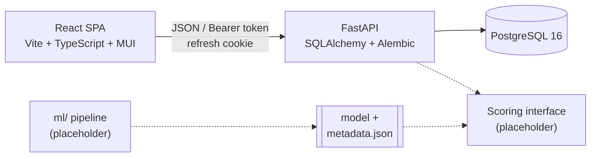

# SalesMesh

SalesMesh is a distributed sales-agent onboarding platform, built as a
final-year capstone project. Admins approve and manage sales agents, agents
work through onboarding, and clients follow onboarding reports. The project's
AI engine will detect fraudulent agent behaviour and assign risk and reputation
scores from 0 to 100.

**Current status:** authentication, role-based workspaces, development
automation, and the scoring interface are complete. No dataset has been
selected yet, so there is no domain data model and no trained model. Pages that
depend on that data show clear empty states, and the scoring interface refuses
to return scores until a real model is connected.

## Features

- Secure authentication: Argon2id password hashing, short-lived JWT access
  tokens, rotating refresh tokens in httpOnly cookies, and session revocation
  when a stolen refresh token is reused.
- Agent self-registration with email verification and admin approval.
- Admin tools to create clients and admins, approve or reject agents,
  activate or deactivate users, change roles, and read the audit log.
- Login rate limiting, account lockout, and audit logging of security events.
- Responsive admin, agent, and client workspaces built with React and MUI.
- One-command Docker Compose startup, pre-commit hooks, GitHub Actions CI, and
  Dependabot.

## Architecture



| Layer | Technology |
| --- | --- |
| Frontend | React 19, Vite, TypeScript, MUI, React Router, TanStack Query, axios, react-hook-form, zod |
| Backend | FastAPI, pydantic-settings, SQLAlchemy 2.0, Alembic, Argon2, PyJWT |
| Database | PostgreSQL 16 (Docker) |
| Tooling | Docker Compose, Ruff, pytest, ESLint, Prettier, Vitest, pre-commit, GitHub Actions |

See [architecture](docs/architecture.md) and the
[authentication overview](docs/authentication.md) for diagrams.

## Prerequisites

- Windows with PowerShell
- Git
- Docker Desktop with Linux containers and Compose v2
- Python 3.14
- Node.js 22.13 or newer with npm

## Windows Setup

```powershell
git clone https://github.com/Myranyamwanda/Salesmesh.git
Set-Location Salesmesh
git switch develop
Copy-Item .env.example .env
notepad .env   # set POSTGRES_PASSWORD (and POSTGRES_PORT if 5432 is in use)
python -m venv backend/.venv
backend/.venv/Scripts/python.exe -m pip install -r backend/requirements-dev.txt
backend/.venv/Scripts/python.exe backend/manage.py init-secret
.\scripts\dev.ps1 up
.\scripts\dev.ps1 create-admin -Email admin@example.com
```

Open <http://localhost:5173> and sign in as the admin. The API documentation is
at <http://localhost:8000/docs>. The [setup guide](docs/setup-guide.md) walks
through each step, registering and approving an agent, and troubleshooting.

## Commands

| Command | Purpose |
| --- | --- |
| `.\scripts\dev.ps1 up` | Build and start PostgreSQL, the API, and the frontend; apply migrations |
| `.\scripts\dev.ps1 down` | Stop all services (the database volume is kept) |
| `.\scripts\dev.ps1 migrate` | Apply Alembic migrations |
| `.\scripts\dev.ps1 create-admin -Email <address>` | Create the first admin account |
| `.\scripts\dev.ps1 test` | Run backend tests against the separate test database |
| `.\scripts\dev.ps1 lint` | Run Ruff and ESLint |
| `npm test` / `npm run build` (in `frontend/`) | Run frontend tests / production build |

## Project Structure

```text
salesmesh/
├── backend/
│   ├── app/
│   │   ├── api/          HTTP routes: health, auth, admin
│   │   ├── core/         settings, security, errors, logging
│   │   ├── db/           database engine and sessions
│   │   ├── ml/           scoring interface (placeholder)
│   │   ├── models/       SQLAlchemy tables (authentication and audit only)
│   │   ├── schemas/      Pydantic request and response models
│   │   └── services/     authentication, audit, and email logic
│   ├── alembic/          database migrations
│   ├── tests/            pytest suite
│   └── manage.py         init-secret and create-admin commands
├── frontend/src/
│   ├── api/  auth/  components/  hooks/  layouts/
│   └── pages/  routes/  types/  utils/
├── ml/
│   ├── src/              pipeline placeholders: load, features, train, evaluate, export
│   ├── notebooks/        exploratory analysis (empty until data arrives)
│   └── artifacts/        generated models (ignored by Git)
├── data/                 datasets (ignored by Git)
├── docs/                 project documentation
├── scripts/dev.ps1       PowerShell development commands
├── .github/              CI workflows, Dependabot, issue and PR templates
└── docker-compose.yml
```

## Documentation

| Guide | Contents |
| --- | --- |
| [Setup guide](docs/setup-guide.md) | Clean-clone Windows setup and first sign-in |
| [Architecture](docs/architecture.md) | Components, layers, and design decisions |
| [Authentication overview](docs/authentication.md) | Login, refresh, verification, and role diagrams |
| [API summary](docs/api-summary.md) | Endpoints, access rules, and error format |
| [ML model service](docs/ml-scoring.md) | Model loading, version and golden checks, model status |
| [Development workflow](docs/development-workflow.md) | Compose, hooks, CI, and branch protection |
| [Backend foundation](docs/backend-foundation.md) | Settings, database, logging, and tests |
| [Backend authentication](docs/backend-authentication.md) | Security design and settings |
| [Frontend authentication](docs/frontend-authentication.md) | Session handling and auth pages |
| [Workspace pages](docs/workspace-pages.md) | Role layouts and empty-state pages |

## Branches

| Branch | Purpose |
| --- | --- |
| `main` | Stable, released work |
| `develop` | Integration branch; all feature work merges here first |
| `feature/<phase-name>` | One branch per phase, created from `develop` |
| `chore/<topic>` | Small maintenance changes, created from `develop` |

Feature branches are merged into `develop` through pull requests after CI
passes. `develop` is merged into `main` through a pull request when a phase is
complete.

## Commits

Commits follow [Conventional Commits](https://www.conventionalcommits.org/):

| Prefix | Use |
| --- | --- |
| `feat:` | New functionality |
| `fix:` | Bug fix |
| `docs:` | Documentation only |
| `test:` | Tests only |
| `ci:` | CI, hooks, or automation |
| `chore:` | Maintenance and configuration |

Example: `feat: add scoring interface placeholder`.

## Development Phases

1. Structure and development environment
2. Backend foundation
3. Backend authentication
4. Frontend foundation and authentication
5. Layouts and pages
6. Automation
7. ML placeholder and documentation
