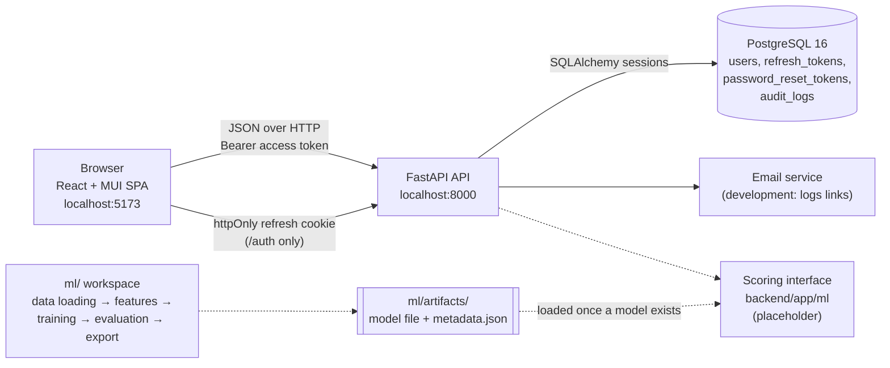
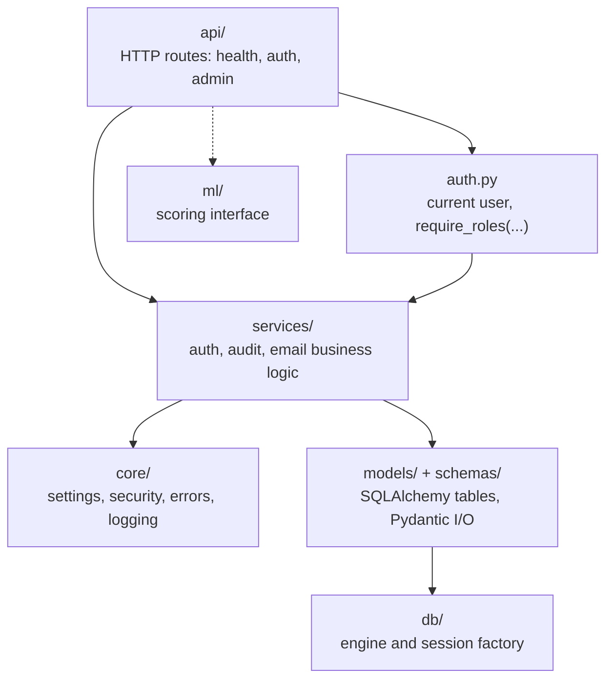
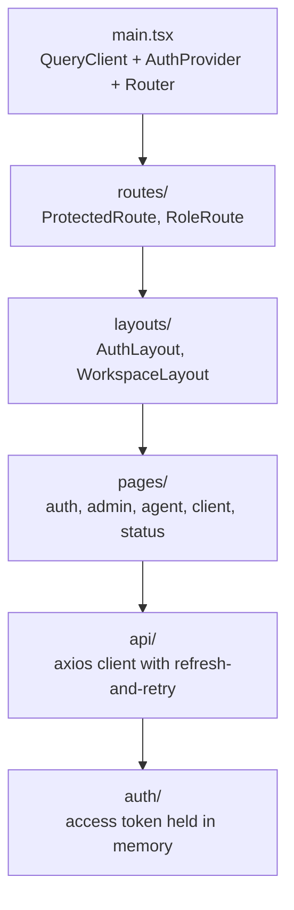

# Architecture

SalesMesh is a three-tier web application: a React single-page app, a FastAPI
API, and a PostgreSQL 16 database. A separate `ml/` workspace will produce the
fraud-detection model that the API loads. Docker Compose runs the three tiers
together for development.

## System Overview

Solid lines are implemented. Dotted lines are the planned model path: no
dataset has been selected, so the placeholder raises an error instead of
returning scores.

## Backend Layers

Routes stay thin: they validate input with Pydantic schemas and call a service
function. Services hold the rules (token rotation, lockout, approvals) so they
can be tested without HTTP. Keeping all settings in one `Settings` class means
every configurable value is read from `.env` and documented in `.env.example`.

## Frontend Structure

Each role has its own workspace (`/admin`, `/agent`, `/client`). Pages that
depend on the future dataset show titled layouts with empty states rather than
invented data.

## Runtime Environments

| Environment | How it runs | Database |
| --- | --- | --- |
| Compose development | `.\scripts\dev.ps1 up` builds and starts all three services; the API applies migrations on start | `postgres_data` named volume |
| Host development | Uvicorn from `backend/.venv` and `npm run dev` in `frontend/` | Compose PostgreSQL on `POSTGRES_PORT` |
| Tests | pytest against a separate database ending in `_test` | `TEST_POSTGRES_DB` |
| CI | GitHub Actions `backend` and `frontend` workflows | PostgreSQL 16 service container |

## Key Decisions

- **Synchronous SQLAlchemy.** Simpler to read and test than async; FastAPI runs
  sync routes in a thread pool, which is sufficient at this scale.
- **Access token in memory, refresh token in an httpOnly cookie.** JavaScript
  cannot read the long-lived token, which limits damage from XSS; the short
  access token is lost on reload and restored through the cookie.
- **Model behind an interface.** The API depends on `ScoringModel`, not on a
  training library, so the model can be replaced without changing routes.
- **No domain tables yet.** Agent, onboarding, and score tables wait for the
  dataset so the schema matches real data rather than guesses.
