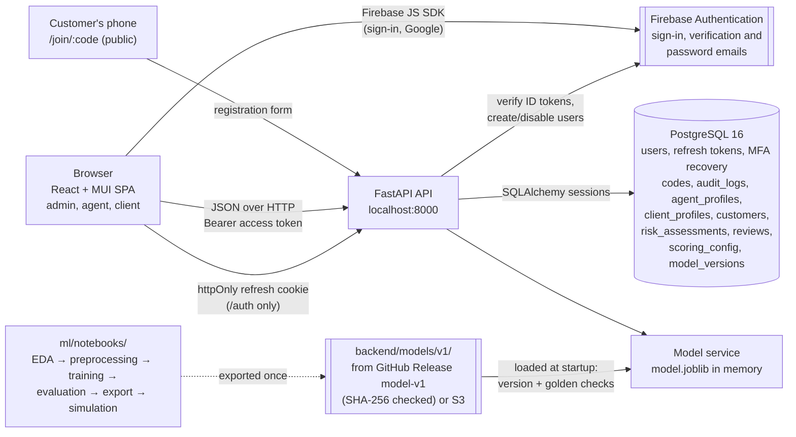
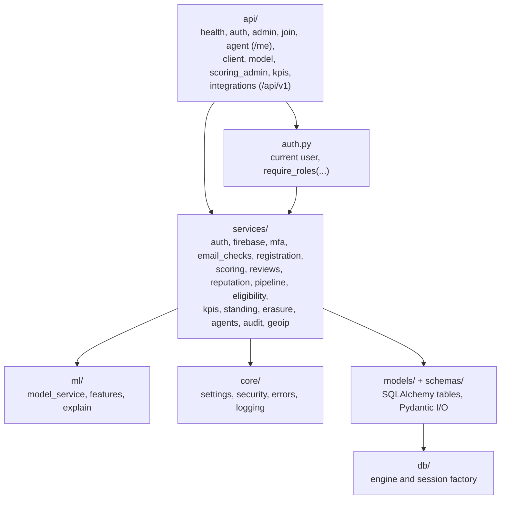
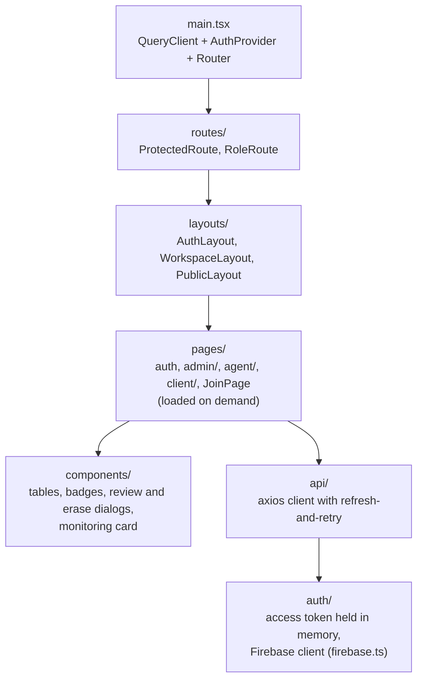

# Architecture

SalesMesh is a three-tier web application: a React single-page app, a FastAPI
API, and a PostgreSQL 16 database. The API loads a trained scikit-learn model
once at startup and scores every customer registration with it. The model was
trained in the Jupyter notebooks in `ml/notebooks/`. Docker Compose runs the
three tiers together for development.

## System Overview

The registration flow, step by step, is shown as a sequence diagram in
[ML integration](ml-integration.md#registration-flow).

## Backend Layers

Routes stay thin: they validate input with Pydantic schemas and call a service
function. Services hold the rules (scoring, review decisions, reputation,
token rotation, admin MFA), so they can be tested without HTTP. All calls to
Firebase go through `services/firebase.py`, which tests replace with a fake. `ml/` contains
everything that knows about the model: loading and checking it, building the
13 features from a registration, and explaining a score. Keeping all settings
in one `Settings` class means every configurable value is read from `.env` and
documented in `.env.example`.

## Frontend Structure

Each role has its own workspace (`/admin`, `/agent`, `/client`), and customers
use the public `/join/:code` page. Every page is loaded with `React.lazy`, so a
user downloads only the pages they open.

## Runtime Environments

| Environment | How it runs | Database |
| --- | --- | --- |
| Compose development | `.\scripts\dev.ps1 up` builds and starts all three services; the API applies migrations on start; `backend/models` is mounted read-only | `postgres_data` named volume |
| LAN development | `.\scripts\dev.ps1 up-lan` adds `docker-compose.lan.yml` so a phone on the same Wi-Fi can open the app | Same volume |
| Host development | Uvicorn from `backend/.venv` and `npm run dev` in `frontend/` | Compose PostgreSQL on `POSTGRES_PORT` |
| Tests | pytest against a separate database ending in `_test`; a small model trained in the tests stands in for the real one | `TEST_POSTGRES_DB` |
| CI | GitHub Actions `backend` and `frontend` workflows; the 4 real-model tests are skipped because model files are not in Git | PostgreSQL 16 service container |

## Key Decisions

- **Synchronous SQLAlchemy.** Simpler to read and test than async; FastAPI runs
  sync routes in a thread pool, which is sufficient at this scale.
- **Access token in memory, refresh token in an httpOnly cookie.** JavaScript
  cannot read the long-lived token, which limits damage from XSS; the short
  access token is lost on reload and restored through the cookie.
- **The model is loaded once and checked before use.** A version check and 20
  golden examples run at startup; on failure the API stays up, reports
  `model: failed`, and refuses to score, rather than serving wrong scores.
- **Model plus transparent rules.** Features are clipped to the training range
  before the model sees them, and a rule catches extreme values; every reason
  says whether it came from the model or a rule.
- **Human review for every flag.** At about 9% precision most flags are
  genuine customers, so the model only routes registrations to a person.
- **Reputation is calculated on read.** There is no reputation table, so a
  reputation can never be out of date after a registration, review, setting
  change, or erasure.
- **Least privilege per role.** Only admins see model output. Agents see
  their referral link, customer names, a monthly standing label, and monthly
  totals, and clients see only confirmed outcomes, so the scores cannot be
  gamed or misread.
- **Statuses and KPIs are derived, not stored.** The registration status,
  commission eligibility, monthly KPIs, and reputation at a past month end are
  all computed from the assessments and reviews, so they always agree with
  each other and with the live reputation (a test checks the current month).
- **Coarse, delayed views outside the admin role.** Agents see a monthly
  standing label and monthly totals; clients see pending registrations only
  as a total. Neither can work out which customers were flagged.
- **Versioned integration API.** `/api/v1` is a separate router whose fields
  are only ever added, so other modules can rely on it; it is rate-limited
  from the audit log, which works with several API workers.
- **Model files outside Git.** Binaries are downloaded from a GitHub Release
  and verified with SHA-256 checksums that are tracked in Git.
