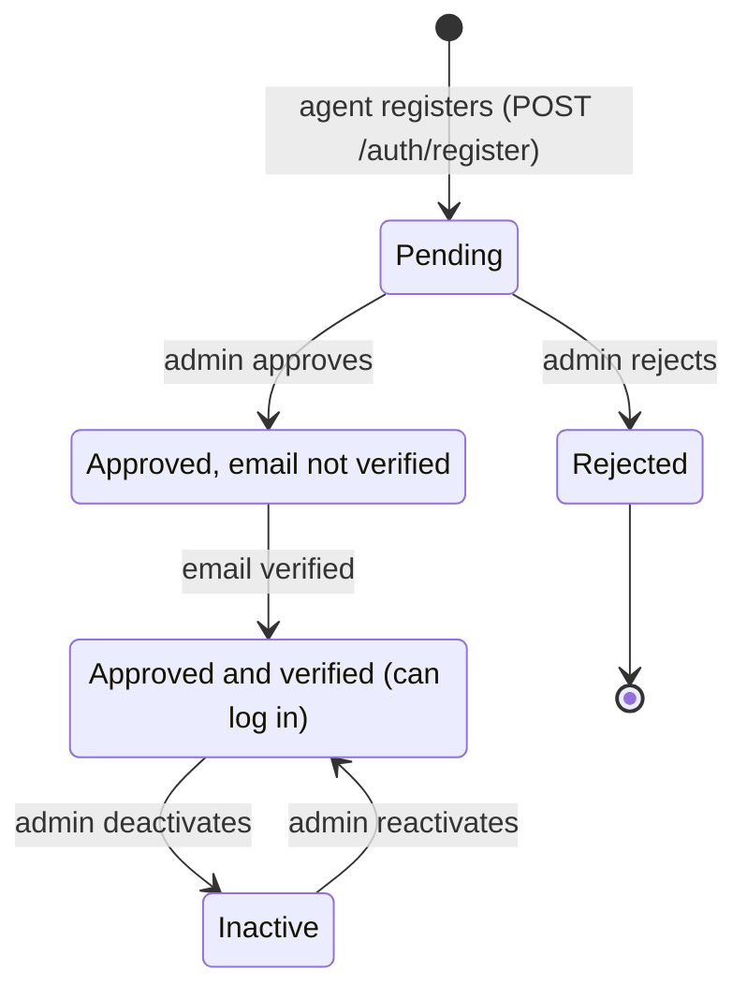
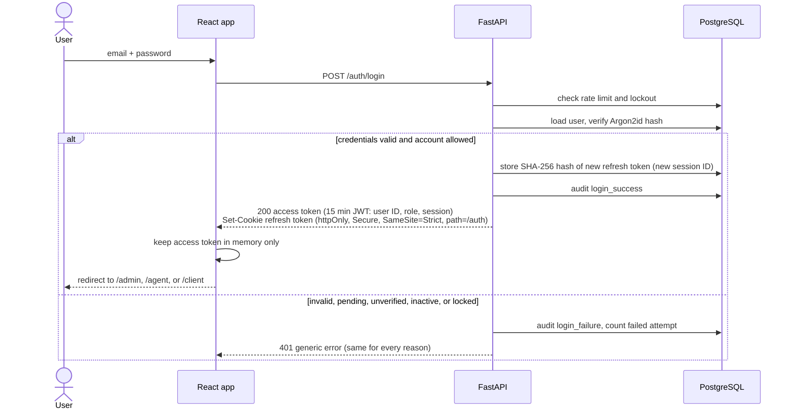
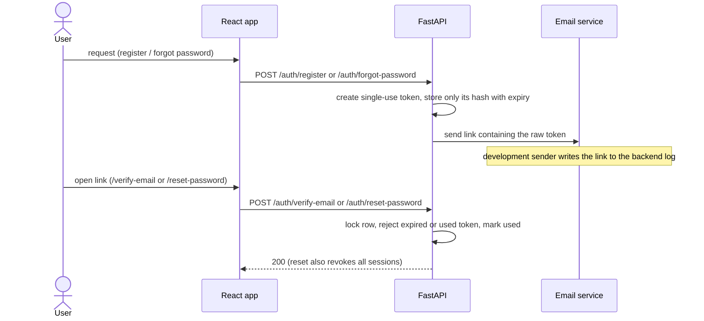

# Authentication Overview

This page shows the authentication flows as diagrams. Security details and
settings are in [backend authentication](backend-authentication.md) and
[frontend authentication](frontend-authentication.md); endpoints are listed in
the [API summary](api-summary.md).

## Roles and Account Lifecycle

Accounts have one role: `admin`, `agent`, or `client`. These are login roles
only, not domain records. Agents register themselves; admins create clients and
other admins. The first admin is created from the terminal.

Approval and email verification can happen in either order; both are required
before login. Admin-created accounts start approved but must still verify
their email.

## Login

## Refresh Rotation and Reuse Detection

The frontend sends only one refresh request at a time, because two concurrent
refreshes with the same token would look like reuse and end the session.

## Email Verification and Password Reset

## Authorisation

Protected routes use `require_roles(...)`. It checks the JWT signature and
expiry, then reloads the user so deactivation, role changes, and logout take
effect immediately.

| Situation | Response |
| --- | --- |
| No token, bad signature, expired, or revoked session | 401 |
| Valid token, wrong role (for example an agent calling `/admin/users`) | 403 |

On the frontend, `ProtectedRoute` sends signed-out users to `/login` and
`RoleRoute` sends users with the wrong role to `/403`.
