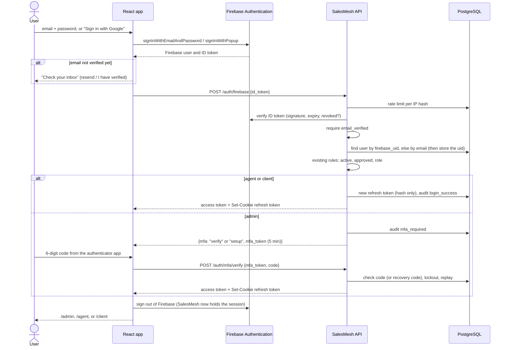
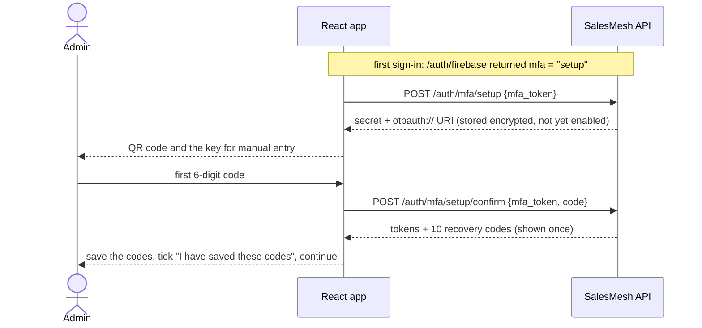
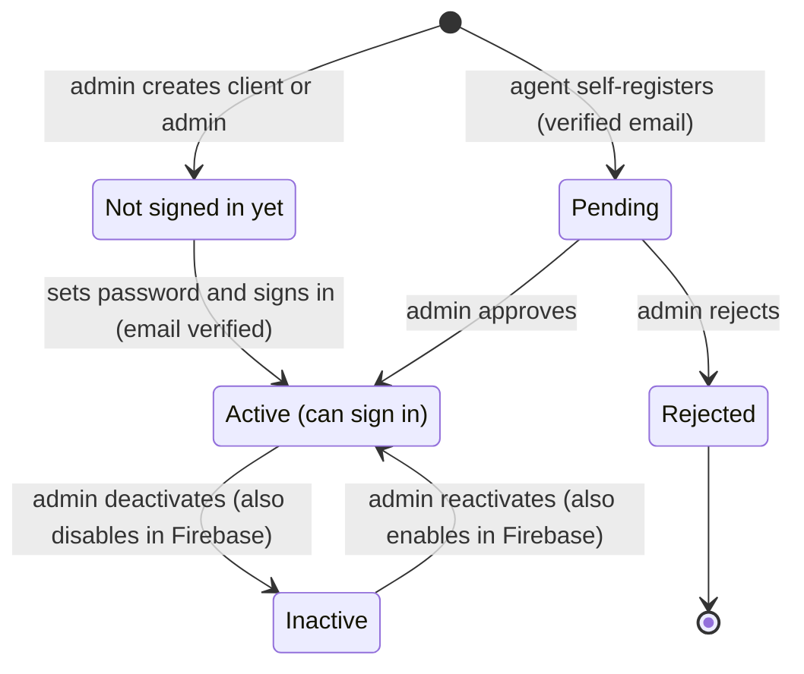
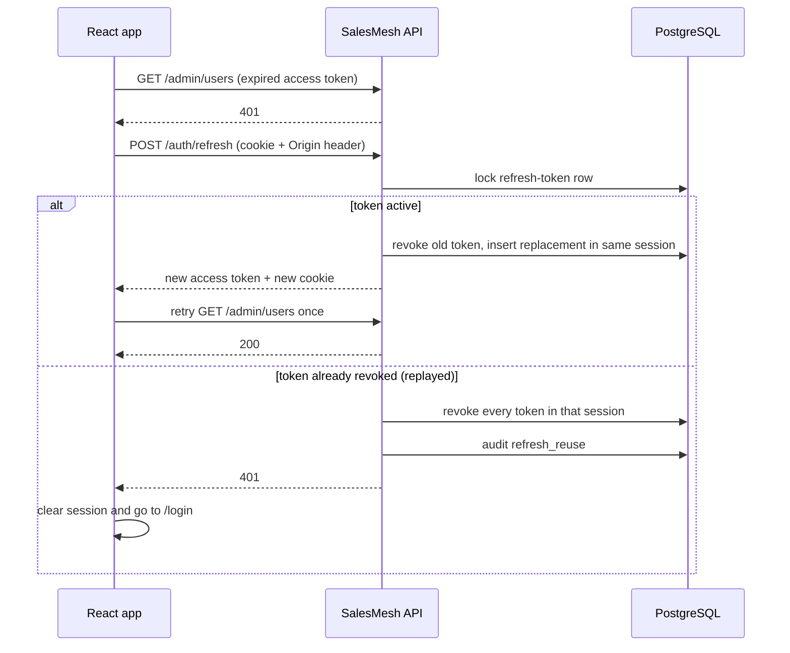

# Authentication

Since v1.1.0, SalesMesh uses **Firebase Authentication** to prove who someone
is, and keeps everything about what they may do in its own backend. This page
explains the split, the sign-in flow, admin multi-factor authentication (MFA),
how each kind of account is created, and how to set up Firebase as a new
developer. Endpoints are listed in the [API summary](api-summary.md).

## Who Does What

| Firebase Authentication (identity) | SalesMesh backend (authorisation) |
| --- | --- |
| Sign-up and sign-in with email and password, or Google | Roles (`admin`, `agent`, `client`) and role-based access control |
| Email verification emails | Agent approval (pending, approved, rejected) |
| "Set your password" and "Reset your password" emails | Active / deactivated accounts |
| Password policy (12+ characters, upper and lower case, a number, a symbol) | Sessions: a 15-minute access token and a rotating refresh cookie |
| Brute-force protection for passwords | Admin authenticator codes (TOTP) and recovery codes |
| | Rate limiting, lockout for wrong admin codes, and the audit log |
| | All fraud scoring, reviews, reputation, and erasure (unchanged) |

SalesMesh stores no passwords. A user row holds the Firebase user ID
(`firebase_uid`), the role, the approval status, and the session data. The
browser keeps Firebase's sign-in in memory only and drops it as soon as the
SalesMesh session starts, so the httpOnly refresh cookie is the only
long-lived session.

## Sign-in

When `/auth/firebase` cannot sign someone in, it answers with a stable error
code so the page can react:

| Code | Status | Meaning | What the page does |
| --- | --- | --- | --- |
| `email_not_verified` | 403 | Firebase has not verified the email | Shows "Check your inbox" |
| `account_not_found` | 404 | No SalesMesh account uses this email | Offers agent registration |
| `account_pending` | 403 | Agent awaiting approval | Opens the waiting page |
| `account_inactive` | 403 | Deactivated, rejected, or disabled in Firebase | Shows the message |
| `account_link_conflict` | 409 | The account is linked to a different Firebase user | Shows the message |
| `http_401` | 401 | Invalid, expired, or revoked ID token | Shows the message |
| `http_429` | 429 | Too many attempts from this network | Shows the message |

Every attempt is audited (`login_success`, `login_failure`, `mfa_failure`)
with a hashed IP address. No ID token, code, or password is ever stored in the
audit log.

**Linking accounts.** The first Firebase sign-in with a verified email links
an existing SalesMesh account with that email by storing its `firebase_uid`;
after that the uid is used, even if the Firebase email changes. An unverified
email never links an account.

## Admin Multi-factor Authentication

Admins confirm every sign-in with a time-based code (TOTP, RFC 6238) from an
authenticator app, such as Google Authenticator, Microsoft Authenticator, or
the Authenticator browser extension. Agents and clients do not need one.

- **The MFA token** is a JWT with its own audience (`salesmesh-api-mfa`) that
  lasts 5 minutes. It cannot be used as an access token, and deactivating the
  admin or changing their role cancels it.
- **Secrets** are encrypted with `TOTP_ENCRYPTION_KEY` (Fernet), generated by
  `manage.py init-secret`. A database leak alone does not reveal them. If the
  key changes, every admin must set up their authenticator again.
- **Codes are single-use.** Codes from the previous, current, and next
  30-second step are accepted (clock drift), but never a step that was already
  used.
- **Recovery codes.** Ten codes of 12 characters, each valid once. Only their
  SHA-256 hashes are stored. Case and dashes do not matter when typing them.
- **Lockout.** Wrong codes count towards `LOGIN_FAILURE_LIMIT` (default 5);
  after that the account is locked for `ACCOUNT_LOCKOUT_MINUTES` (default 15)
  and the API answers 429 `mfa_locked`.
- **Lost phone and no recovery codes.** From a terminal:
  `.\scripts\dev.ps1 reset-mfa -Email <admin email>`. It removes the
  authenticator and ends the admin's sessions; the next sign-in sets up a new
  one.
- **Setup cannot be restarted** while an authenticator is enabled, so someone
  who learns only the password cannot enrol their own device.

## Creating Accounts

| Role | How the account is created | How the password is set |
| --- | --- | --- |
| Agent | Self-registration at `/register`: Firebase sign-up (email and password, or Google), verify the email, then give a display name. The backend creates a pending agent. | Chosen at sign-up (the form enforces the policy); Google accounts need none |
| Client or admin | An admin uses **User management > Create account**. The backend creates the Firebase user without a password and the browser asks Firebase to send a "set your password" email. | From that email. "Send password email" sends it again. Google sign-in also works for the same address |
| Admin (from a terminal) | `.\scripts\dev.ps1 create-admin -Email <address>` creates the admin in SalesMesh and Firebase, even when other admins exist (audited as `admin_created_cli`) | From the one-time link the command prints. Do not share it |
| Demo users | `.\scripts\dev.ps1 seed-demo` creates the 44 `@demo.example.com` users, already verified, with `DEMO_PASSWORD` | `DEMO_PASSWORD`; the demo admin's authenticator key is printed once |

Only the agent role can register itself. Agent self-registration and the
public `/join` page also refuse email addresses that cannot receive mail (see
[real-email checks](#real-email-checks)).

**Deactivate users in SalesMesh, not in the Firebase console.** Deactivating
in **User management** (or with `deactivate-user`) also disables the Firebase
user, revokes its Firebase refresh tokens, and ends every SalesMesh session at
once. Disabling a user only in the Firebase console stops new sign-ins but
leaves an existing SalesMesh session running until its refresh token expires,
because SalesMesh does not ask Firebase on every refresh.

**At least one usable admin always remains.** A usable admin is active,
approved, verified, linked to Firebase, and has an authenticator set up. The
API and `deactivate-user` refuse to deactivate or demote an admin if no other
usable admin would remain, and an admin cannot deactivate themselves.

## Replacing an Admin Whose Email Cannot Receive Mail

An admin account on an address that cannot receive email (such as
`@example.com`) can never verify in Firebase, so it cannot be linked. Replace
it with a new admin on a real address instead of deleting it, so that its
audit history stays:

1. Create the new admin: `.\scripts\dev.ps1 create-admin -Email you+admin@gmail.com`.
   Open the printed link and set the password.
2. Sign in at `http://localhost:5173` as the new admin with email and password,
   set up the authenticator, and save the recovery codes.
3. As the new admin, open **User management** and switch the old admin off.
   From a terminal instead: `.\scripts\dev.ps1 deactivate-user -Email <old address>`.

The old account is kept, inactive, with its audit entries. Step 3 is refused
until step 2 has made the new admin usable.

**Plus-addresses.** Gmail delivers `you+admin@gmail.com` to `you@gmail.com`,
but Firebase treats them as different accounts. That gives several test
accounts one inbox. A plus-address admin signs in with **email and password,
not Google**: "Sign in with Google" uses the Google account's own address
(`you@gmail.com`), which would sign in as whichever SalesMesh account uses that
address.

## Sessions and Authorisation

These are unchanged from v1.0.0. After any successful sign-in the API issues a
15-minute access token (user ID, role, session ID, token version) and an
httpOnly, Secure, SameSite=Strict refresh cookie limited to `/auth`. The
frontend keeps the access token in memory only.

The frontend sends only one refresh request at a time, because two concurrent
refreshes with the same token would look like reuse and end the session.
Logout ends one session, "log out everywhere" ends them all, and changing the
password (through Firebase) also signs the user out everywhere.

Protected routes use `require_roles(...)`. It checks the JWT signature and
expiry, then reloads the user so deactivation, role changes, and logout take
effect immediately.

| Situation | Response |
| --- | --- |
| No token, bad signature, expired, or revoked session | 401 |
| Valid token, wrong role (for example an agent calling `/admin/users`) | 403 |

On the frontend, `ProtectedRoute` sends signed-out users to `/login` and
`RoleRoute` sends users with the wrong role to `/403`.

## Real-email Checks

Agent self-registration (`POST /auth/firebase/register`) and public customer
registration (`POST /join/{code}/register`) refuse an address, with the field
message **"Use a permanent email address"** (422, code `email_not_permanent`),
when:

- its domain, or a parent domain, is on the vendored list of disposable email
  domains (`backend/app/data/disposable_email_domains.txt`, from
  [disposable-email-domains](https://github.com/disposable-email-domains/disposable-email-domains),
  CC0; the source commit and date are in the file header), or
- its domain publishes no mail server (no MX record, or a "null MX").

If DNS does not answer within `EMAIL_DNS_TIMEOUT_SECONDS` (default 2), the
address is accepted and `email_dns_unavailable` is logged, so a DNS outage
never blocks registrations. Some home routers never answer for a domain that
does not exist; setting `EMAIL_DNS_SERVERS=1.1.1.1,8.8.8.8` sends the lookups
to public DNS instead. On `/join`, the check runs after the rate limit, and it
does not change scoring. The demo seed does not use these checks. Tests replace
DNS with a fake.

## Firebase Setup for a New Developer

Do this once per developer machine (or share one project in a team). The free
**Spark** plan is enough.

1. In the [Firebase console](https://console.firebase.google.com/), create a
   project. Note its **Project ID**.
2. **Authentication > Sign-in method:** enable **Email/Password** and
   **Google**.
3. **Authentication > Settings > Password policy:** require at least 12
   characters with upper case, lower case, a number, and a symbol. (The
   sign-up and change-password forms enforce this too.)
4. **Authentication > Settings > Authorized domains:** keep `localhost`. It is
   there by default.
5. **Project settings > General > Your apps:** add a **Web app**. Copy
   `apiKey`, `authDomain`, `projectId`, and `appId` from its configuration.
6. **Project settings > Service accounts > Generate new private key.** Save the
   JSON file **outside the repository**, for example
   `C:\Users\<you>\secrets\salesmesh-firebase-admin.json`. It is a secret: never
   commit, copy, or share it. File names matching `*firebase-admin*.json` are
   ignored by Git and blocked by the pre-commit hook.
7. In the root `.env`, set **all six** variables (see `.env.example`):

   | Variable | Value |
   | --- | --- |
   | `VITE_FIREBASE_API_KEY` | `apiKey` from step 5 |
   | `VITE_FIREBASE_AUTH_DOMAIN` | `authDomain` |
   | `VITE_FIREBASE_PROJECT_ID` | `projectId` |
   | `VITE_FIREBASE_APP_ID` | `appId` |
   | `FIREBASE_PROJECT_ID` | the same Project ID (read by the backend) |
   | `FIREBASE_CREDENTIALS_PATH` | the key file from step 6, with forward slashes |

   The four browser values **must** start with `VITE_`; Vite gives the browser
   only `VITE_*` variables. Docker mounts the key file read-only at
   `/run/secrets/firebase-admin.json`, so `.env` keeps the Windows path.
8. Run `backend/.venv/Scripts/python.exe backend/manage.py init-secret` to add
   `TOTP_ENCRYPTION_KEY` (and `JWT_SECRET` if missing) to `.env`, then
   `.\scripts\dev.ps1 up`.

Without the Firebase settings the API still starts, but `/auth/firebase`
answers 503 "Sign-in is not configured", and `seed-demo`, `reset-demo`,
`create-admin`, and `deactivate-user` stop with a clear message. Tests and CI
never use Firebase: they use the fake in `backend/tests/conftest.py`.

## Known Limitations

- **Sign-in needs `localhost`.** Firebase sign-in works only on an authorized
  domain, and a LAN IP address is not one (Firebase answers
  `auth/unauthorized-domain`). In `up-lan` mode (`http://<LAN IP>:5173`) the
  public `/join` page works on a phone, but signing in does not; use
  `http://localhost:5173` on the computer for that.
- **Emails may land in spam.** Firebase's verification and password emails
  come from `noreply@<project>.firebaseapp.com`.
- **Spark plan quotas.** Firebase limits how many emails and new accounts a
  free project handles per day; enough for development and demos.
- **Google on Gmail addresses.** If someone has an unverified password account
  on a Gmail address and then signs in with Google, Firebase replaces the
  password sign-in with Google (Google is trusted for Gmail). The Firebase uid
  stays the same, so the SalesMesh link is unaffected.
- **Firebase-only deactivation** does not end a running SalesMesh session (see
  [Creating Accounts](#creating-accounts)).
