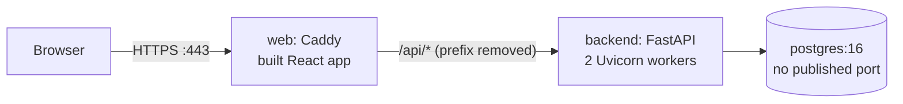

# Production deployment (AWS Lightsail, Ubuntu 24.04)

SalesMesh runs on one Lightsail server (2 GB RAM) with Docker Compose and a
DuckDNS host name, for example `salesmesh.duckdns.org`. The development setup
(`docker-compose.yml`, `scripts/dev.ps1`) is separate and unchanged.

## How production differs from development



| Topic | Development | Production |
| --- | --- | --- |
| Frontend | Vite dev server on :5173 | Built files served by Caddy |
| API address | `http://localhost:8000` | `https://<DOMAIN>/api` (same origin) |
| HTTPS | none | Caddy, automatic Let's Encrypt certificate; HTTP redirects to HTTPS |
| Database port | `127.0.0.1:5432` | not published |
| Backend | 1 worker | 2 workers, `restart: unless-stopped`, no access log |
| Compose project | `salesmesh` | `salesmesh-prod` (separate containers and volumes) |

Decisions:

- **API under `/api` on the same origin.** Browser routes such as `/join/<code>`
  and `/admin` also exist as API paths, so the API gets its own prefix, which
  Caddy removes before passing the request on. The same origin means no CORS
  requests, and the `SameSite=Strict` refresh cookie works. A separate API
  subdomain would also work, but it needs a second certificate and CORS.
- **Cookie path.** The backend sets the refresh cookie for `Path=/auth`; Caddy
  rewrites it to `/api/auth` so the browser sends it to `/api/auth/refresh`.
  No application code changed.
- **Client IP.** Rate limits and the `foreign_request` feature need the
  visitor's IP. Caddy replaces any `X-Forwarded-For` sent by the client with the
  real address (tested: a forged header is ignored), and Uvicorn reads it
  (`--proxy-headers`). The backend publishes no port, so only Caddy can set it.
- **Personal data in logs.** Uvicorn's access log is off (it contains IPs and
  `/join` codes); Caddy keeps no access log; application logs record only
  method, status, and duration. Docker keeps at most 3 x 10 MB per service.
- **Memory.** Measured on the laptop test: about 500 MB at idle (backend
  450 MB with two workers, postgres 40 MB, Caddy 16 MB). Images are built one
  at a time and the Node build is capped at 1 GB; a 2 GB swap file covers peaks.
- **Paths.** The reputation API (`/api/v1/agents/{id}/reputation`) is reached
  at `https://<DOMAIN>/api/api/v1/agents/{id}/reputation`. FastAPI's `/docs`
  page is not usable through the prefix; use the development setup or
  [API summary](api-summary.md).

## Files

| File | Purpose |
| --- | --- |
| `docker-compose.prod.yml` | postgres, backend, web (Caddy) |
| `deploy/web.Dockerfile` | Builds the React app, then a Caddy image with the files |
| `deploy/Caddyfile` | HTTPS, security headers, `/api` proxy, SPA fallback |
| `.env.production.example` | Every production setting; copy to `.env` on the server |
| `scripts/fetch-model.sh` | Model v1 download with SHA-256 checks (as `fetch-model.ps1`) |
| `scripts/deploy.sh` | Backup, pull, build, start, health check |
| `scripts/backup.sh` | `pg_dump -Fc` to `/opt/salesmesh/backups`, keeps 14 days |

## What goes on the server

| Item | Where | How |
| --- | --- | --- |
| Code | `/opt/salesmesh/app` | `git clone` (the repository is public) |
| Model files | `/opt/salesmesh/app/backend/models/v1` | `scripts/fetch-model.sh` |
| Firebase service-account key | `/opt/salesmesh/secrets/firebase-admin.json` | `scp` from Windows |
| `.env` | `/opt/salesmesh/app/.env` | from `.env.production.example`; secrets generated on the server |
| Backups | `/opt/salesmesh/backups` | `scripts/backup.sh` (cron) |

Only the Firebase key file is copied from your laptop. The four Firebase web
values, `FIREBASE_PROJECT_ID`, and the privacy contact email are typed into the
server's `.env` (they are not secret). `JWT_SECRET`, `TOTP_ENCRYPTION_KEY`, and
`POSTGRES_PASSWORD` are generated on the server and differ from development.

## First deployment

PowerShell commands run on Windows; all others run on the server over SSH.

### 1. Lightsail instance, static IP, and firewall

1. Lightsail > Create instance > Linux/Unix > OS only > Ubuntu 24.04 LTS;
   the 2 GB plan. Download the default SSH key (`LightsailDefaultKey-<region>.pem`).
2. Networking > Create static IP > attach it to the instance.
3. Instance > Networking > IPv4 firewall: keep SSH (22) and HTTP (80), add
   HTTPS (443). Restrict SSH to your IP if your connection allows it.

### 2. DuckDNS

Sign in at <https://www.duckdns.org>, add the sub domain (for example
`salesmesh`), set its IP to the static IP, and click update. Check from Windows:

```powershell
Resolve-DnsName salesmesh.duckdns.org -Type A
```

The answer must be the static IP before step 9, or Let's Encrypt cannot issue
the certificate.

### 3. Connect over SSH

Windows OpenSSH refuses key files that other users can read, so restrict the
key first:

```powershell
$Key = "$HOME\Downloads\LightsailDefaultKey-eu-west-1.pem"   # your file name
icacls $Key /inheritance:r /grant:r "$($env:USERNAME):R"
ssh -i $Key ubuntu@<STATIC_IP>
```

### 4. Docker, swap, and updates

```bash
sudo apt-get update && sudo apt-get -y upgrade
sudo apt-get install -y ca-certificates curl git
sudo install -m 0755 -d /etc/apt/keyrings
sudo curl -fsSL https://download.docker.com/linux/ubuntu/gpg -o /etc/apt/keyrings/docker.asc
sudo chmod a+r /etc/apt/keyrings/docker.asc
echo "deb [arch=$(dpkg --print-architecture) signed-by=/etc/apt/keyrings/docker.asc] https://download.docker.com/linux/ubuntu $(. /etc/os-release && echo "$VERSION_CODENAME") stable" \
  | sudo tee /etc/apt/sources.list.d/docker.list > /dev/null
sudo apt-get update
sudo apt-get install -y docker-ce docker-ce-cli containerd.io docker-buildx-plugin docker-compose-plugin
sudo usermod -aG docker ubuntu

# 2 GB swap file, used only under memory pressure.
sudo fallocate -l 2G /swapfile
sudo chmod 600 /swapfile
sudo mkswap /swapfile
sudo swapon /swapfile
echo '/swapfile none swap sw 0 0' | sudo tee -a /etc/fstab
echo 'vm.swappiness=10' | sudo tee /etc/sysctl.d/99-swappiness.conf
sudo sysctl --system > /dev/null

exit   # log out and back in so the docker group applies
```

After reconnecting: `docker compose version` and `free -h` (Swap: 2.0Gi).

### 5. Folders and code

```bash
sudo mkdir -p /opt/salesmesh/secrets /opt/salesmesh/backups
sudo chown ubuntu:ubuntu /opt/salesmesh /opt/salesmesh/backups
sudo chmod 700 /opt/salesmesh/secrets /opt/salesmesh/backups
git clone https://github.com/Myranyamwanda/Salesmesh.git /opt/salesmesh/app
cd /opt/salesmesh/app
git checkout --detach v1.3.0-rc1
scripts/fetch-model.sh
```

### 6. Firebase key file (from Windows)

```powershell
scp -i $Key C:\Users\<you>\secrets\salesmesh-firebase-admin.json ubuntu@<STATIC_IP>:/tmp/firebase-admin.json
```

On the server, move it into place. The backend runs as user ID 10001, which
needs read access:

```bash
sudo mv /tmp/firebase-admin.json /opt/salesmesh/secrets/firebase-admin.json
sudo chown root:10001 /opt/salesmesh/secrets/firebase-admin.json
sudo chmod 640 /opt/salesmesh/secrets/firebase-admin.json
```

### 7. `.env`

```bash
cd /opt/salesmesh/app
cp .env.production.example .env
chmod 600 .env
# Generate the three secrets (copy each output into .env):
openssl rand -hex 24                        # POSTGRES_PASSWORD
openssl rand -hex 32                        # JWT_SECRET
openssl rand 32 | base64 | tr '+/' '-_'     # TOTP_ENCRYPTION_KEY
nano .env
```

Set `DOMAIN`, the three generated secrets, `DEMO_PASSWORD`, the five Firebase
values (same project as development), and `VITE_PRIVACY_CONTACT_EMAIL`. Leave
the "Unchanged" section as it is. Clear the terminal history afterwards with
`history -c`.

### 8. Firebase authorised domain

Firebase console > Authentication > Settings > Authorized domains > Add
domain: `salesmesh.duckdns.org`. Without it, Google sign-in and the links in
password-reset emails fail on the server.

### 9. First start

```bash
cd /opt/salesmesh/app
scripts/deploy.sh --no-pull
```

The first build takes several minutes. The script ends with
`Deployed and healthy: https://<DOMAIN>`. If it fails:
`docker compose -f docker-compose.prod.yml logs --tail 50 backend web`.

### 10. Accounts and demo data

```bash
C="docker compose -f docker-compose.prod.yml"
$C exec backend python manage.py create-admin --email you@example.com
$C exec backend python manage.py seed-demo
```

`create-admin` prints a one-time set-password link. `seed-demo` creates the 45
`@demo.example.com` accounts (reusing the Firebase users that already exist)
and prints the demo admin's TOTP key once; add it to an authenticator app.
The demo accounts share `DEMO_PASSWORD` and are reachable from the internet:
use a strong value, and run `$C exec backend python manage.py reset-demo` when
the demonstration is over.

### 11. Daily backups

```bash
crontab -e
# add this line:
15 2 * * * /opt/salesmesh/app/scripts/backup.sh >> /opt/salesmesh/backups/backup.log 2>&1
```

Run `scripts/backup.sh` once by hand to check it. Backups stay on the same
server; for protection against losing the instance, also copy them off
(`scp` to Windows) or enable Lightsail automatic snapshots.

## Smoke test over HTTPS

From Windows PowerShell (`curl.exe` is built into Windows 10 and 11):

```powershell
$D = "salesmesh.duckdns.org"
curl.exe -s "https://$D/api/health"                                   # "status":"ok", "model":"ok"
curl.exe -s -o NUL -w "%{http_code}`n" "http://$D/"                   # 308 (redirect to HTTPS)
curl.exe -s -o NUL -w "%{http_code}`n" "https://$D/join/AGT-NOTREAL"  # 200 (app page)
curl.exe -s -I "https://$D/" | Select-String "Strict-Transport"       # HSTS header present
```

In a browser:

- [ ] The padlock shows a valid certificate for the domain.
- [ ] Sign in as the admin (email and password, then TOTP); Overview loads.
- [ ] Reload the page: you stay signed in (refresh cookie works).
- [ ] Sign in with Google once (authorised domain is set).
- [ ] Agents list and Review queue show the demo data.
- [ ] As a demo agent: copy the referral link, open it on a phone over mobile
      data, register a customer; it appears in the admin's Agents detail.
- [ ] As a demo client: the quality dashboard loads.
- [ ] Sign out; Back does not show the previous page's data.
- [ ] Browser console (F12) shows no `Content-Security-Policy` report lines
      (see below).

## Security headers

Caddy sends HSTS (1 year), `X-Content-Type-Options`, `X-Frame-Options: DENY`,
`Referrer-Policy`, and `Permissions-Policy`. The Content Security Policy is
**report-only** at first: the browser reports violations in the console but
blocks nothing, so an unforeseen Firebase or Google sign-in resource cannot
break the release. After the smoke test shows no reports, change
`Content-Security-Policy-Report-Only` to `Content-Security-Policy` in
`deploy/Caddyfile` and deploy again.

## Updating

```bash
cd /opt/salesmesh/app
scripts/deploy.sh v1.3.0        # the tag to deploy
```

`deploy.sh` takes a backup, checks out the tag, builds, starts (the backend
applies new migrations), and checks `/api/health`. Without an argument it runs
`git pull` on the current branch.

## Rolling back to the previous tag

If the new version applied no migration (same `m00xx` in the backup name
before and after), deploy the previous tag:

```bash
scripts/deploy.sh v1.3.0-rc1
```

If it did apply a migration, the older code cannot start on the newer schema.
Restore the backup that `deploy.sh` took just before the update (its name
contains the old migration), then deploy the previous tag.

## Restore a backup

The code must match the backup's migration (the `m00xx` part of the name).

```bash
cd /opt/salesmesh/app
C="docker compose -f docker-compose.prod.yml"
FILE=/opt/salesmesh/backups/salesmesh-20261105-021500-m0010.dump   # choose
$C stop backend web
$C exec -T postgres sh -c 'dropdb -U "$POSTGRES_USER" "$POSTGRES_DB" && createdb -U "$POSTGRES_USER" "$POSTGRES_DB"'
$C exec -T postgres sh -c 'pg_restore -U "$POSTGRES_USER" -d "$POSTGRES_DB" --no-owner --exit-on-error' < "$FILE"
scripts/deploy.sh <tag matching the backup>
```

These steps were tested with the laptop setup below.

## Testing the production setup on Windows

The same files run on a laptop with `DOMAIN=localhost`; Caddy then uses its own
local certificate authority (browsers show a warning; `curl -k` skips it).
The separate project name keeps the development containers and database
volume untouched. Ports 80 and 443 must be free. From PowerShell:

```powershell
$env:COMPOSE_PROJECT_NAME = "salesmesh-prodtest"
$env:DOMAIN = "localhost"
$env:VITE_PRIVACY_CONTACT_EMAIL = "privacy@example.com"
docker compose -f docker-compose.prod.yml up -d --build --wait
curl.exe -k https://localhost/api/health
docker compose -f docker-compose.prod.yml down -v --rmi local   # clean up
```

This uses the development `.env` (shared Firebase project and keys) with a new,
empty database. Do not run `seed-demo` or `reset-demo` there: they change the
demo users in the shared Firebase project.
