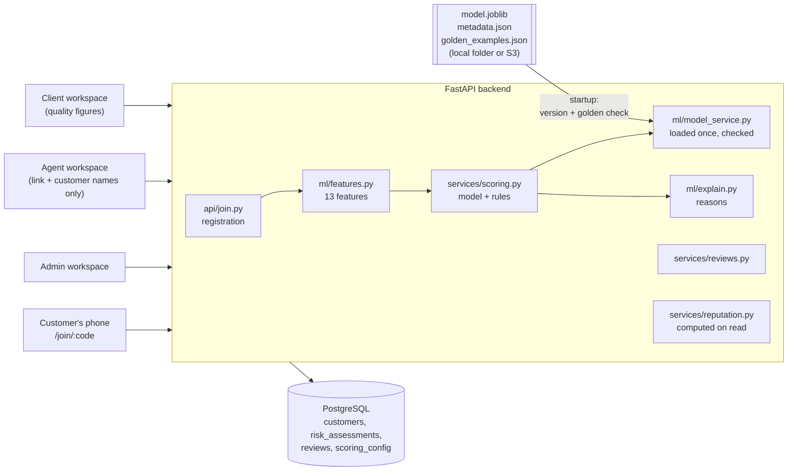
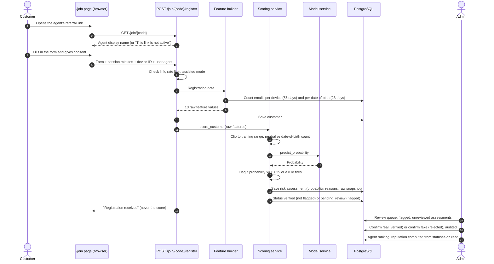

# ML Integration

How the trained fraud model is wired into SalesMesh, from a customer's
registration to an agent's reputation. For the model itself see the
[model card](model-card.md); for features and rules see
[ML model service](ml-scoring.md).

## Architecture

## Registration Flow

## Who Sees What

| Role | Sees | Never sees |
| --- | --- | --- |
| Customer | "Registration received" | Probability, flag, status, reasons |
| Agent | Own referral link; names, dates, and assisted flag of own customers | Customer status, probability, reasons, own reputation |
| Client | Registrations, confirmed fake % (decided by a reviewer), count under review, monthly trend for their agents | Model flags, probabilities, reasons, features |
| Admin | Everything above, plus probabilities, reasons, raw features, reputations, settings, model status | — |

## Startup and Safety Checks

1. The model files come from `MODEL_SOURCE` (local folder or S3).
2. The scikit-learn version must match `metadata.json`, or the model is not
   unpickled.
3. The 20 golden examples must match within 1e-5.
4. If any check fails, `/health` reports `model: failed` and registrations
   return 503 without saving anything. A failed reload keeps the working model.
5. The active version is recorded in `model_versions`, and every assessment
   stores the version that produced it.

## Demo Data

`.\scripts\dev.ps1 seed-demo` creates a demo admin, 3 clients, and 40 agents
(4 fraudulent) on `@demo.example.com`, all verified, approved, and active,
with `DEMO_PASSWORD` from `.env`. About 3,300 rows of
`ml/model_contract/demo_sample.csv` become customers spread over the last 12
months.

- **Demo-only bypass:** the 13 feature values come straight from the CSV
  instead of the feature builder, because the BAF rows already are feature
  values. Names, emails, phone numbers, and dates of birth are invented by
  Faker for display.
- Every customer is scored by the same `score_customer()` as a live
  registration. About 10% are marked assisted, with the same device features
  set to missing.
- Flags older than 60 days are reviewed automatically by the demo admin from
  the dataset label (`fraud_bool` 1 is confirmed fake, 0 confirmed real, note
  "Demo review based on dataset label") through the same review service as
  the API. Newer flags stay pending for a live review during a demonstration.
  `fraud_bool` is never stored.
- The command runs in one transaction, adds nothing if demo data exists, and
  prints the demo logins. `.\scripts\dev.ps1 reset-demo` deletes only demo
  users and their customers.
- The device rule never fires on demo rows, because no BAF row has more than
  2 emails per device. Register 3 different emails from one browser on a
  `/join` link to show it live.

## Code Map

| Concern | File |
| --- | --- |
| Model loading, version and golden checks | `backend/app/ml/model_service.py`, `model_source.py` |
| Feature builder | `backend/app/ml/features.py` |
| Reasons | `backend/app/ml/explain.py` |
| Scoring with rules | `backend/app/services/scoring.py` |
| Public registration | `backend/app/api/join.py`, `services/registration.py` |
| Reviews | `backend/app/services/reviews.py` |
| Reputation | `backend/app/services/reputation.py` |
| Demo data | `backend/app/demo.py` |
| Tables | `backend/app/models/`, migrations `0003` and `0004` |
| End-to-end test | `backend/tests/test_end_to_end.py` |
