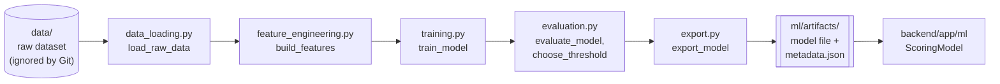

# ML Scoring Placeholder

SalesMesh's AI engine will detect fraudulent agent behaviour and assign risk and
reputation scores from 0 to 100. No dataset has been selected, so this phase
provides only the interface and the pipeline outline. No features, metrics, or
scores are invented.

## Backend Scoring Interface

[`backend/app/ml/scoring.py`](../backend/app/ml/scoring.py) defines:

| Name | Purpose |
| --- | --- |
| `ScoringModel` | Protocol with one method: `score(features) -> ScoreResult` |
| `ScoreResult` | `risk_score`, `reputation_score` (each validated to 0-100), and `model_version` |
| `ModelMetadata` | Loads and checks `metadata.json` from an exported model |
| `PlaceholderScoringModel` | Current implementation; always raises `ModelNotConnectedError` |
| `get_scoring_model()` | Returns the active model; the single place to swap in the real one |

`features` is a plain mapping because the feature names are unknown. The
placeholder raises an error rather than returning example numbers so that no
part of the system can display a score that did not come from a trained model.
The frontend already shows "No data yet - the scoring model is not connected"
on the pages that will use scores.

No API endpoint calls the scoring interface yet. Scoring endpoints need
something to score (agent records), and those wait for the dataset.

## Training Pipeline Outline

`ml/src/` contains one placeholder module per pipeline stage. Each function
raises `NotImplementedError` with a TODO describing the decision still needed.

`ml/notebooks/` is reserved for exploratory analysis of the dataset once it
arrives. No ML libraries are installed yet; they are chosen together with the
algorithm.

## Output Contract

Training must produce two files in `ml/artifacts/`:

1. **A saved model file.** The format depends on the library chosen later.
2. **`metadata.json`**, with exactly these keys:

| Key | Type | Meaning |
| --- | --- | --- |
| `feature_names` | list of strings | Input features in the order the model expects |
| `model_version` | string | Version of the trained model; intended for the admin Model Management page |
| `threshold` | number | Decision cut-off chosen during evaluation |
| `metrics` | object of name → number | Evaluation results; metric names are not yet decided |

`ModelMetadata.from_file` rejects a file with any of these keys missing. The
actual feature names, threshold value, and metrics are decided after the dataset
is approved. Generated artifacts and datasets are ignored by Git.

## Connecting a Real Model Later

1. Add the dataset to `data/` and approve the domain data model.
2. Implement the `ml/src/` stages and export the model and `metadata.json`.
3. Add a `ScoringModel` implementation that loads the artifacts and checks the
   request features against `metadata.feature_names`.
4. Return it from `get_scoring_model()` and add the scoring endpoints and tests.
