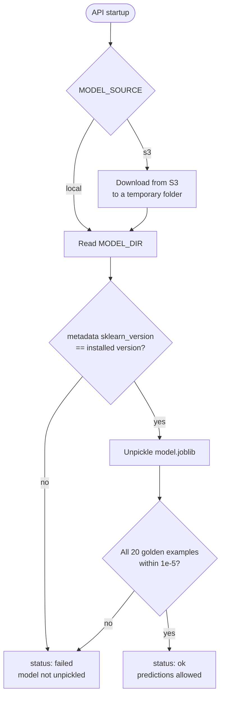

# ML Model Service

The backend serves the trained fake-customer detector: `v1`, a calibrated
logistic regression trained on the BAF Base dataset. The training work in
`ml/notebooks/` is finished and is not changed by the backend. This page
describes how the backend loads and checks the model, turns a customer
registration into model features, and scores it with the model plus
transparent rules. Agent reputation is added in a later phase.

## Model Files

| File | Purpose |
| --- | --- |
| `model.joblib` | scikit-learn `CalibratedClassifierCV` (sigmoid) wrapping `Pipeline(prep, model)`. All preprocessing is inside it. |
| `metadata.json` | Model contract: feature order, categories, threshold (0.035), `sklearn_version`, and test metrics |
| `golden_examples.json` | 20 inputs with the probabilities the model produced at export time |

Copies of the contract files are tracked in `ml/model_contract/`. The model
files themselves live in `backend/models/v1/`, which Git ignores. Docker
Compose mounts that folder read-only at `/app/models`, so the model is never
baked into an image.

## Getting the Model Files

A fresh clone has no model files, because model binaries are never committed.
There are two sources:

1. **GitHub Release (default).** The four files (`model.joblib`,
   `metadata.json`, `golden_examples.json`, `coefficients.json`) are attached
   to the GitHub Release `model-v1`. Run:

   ```powershell
   .\scripts\dev.ps1 fetch-model
   ```

   [`scripts/fetch-model.ps1`](../scripts/fetch-model.ps1) downloads each file
   into `backend/models/v1/` and checks its SHA-256 against
   [`ml/model_contract/model-v1.sha256`](../ml/model_contract/model-v1.sha256),
   which is tracked in Git. A file that does not match is deleted, never kept,
   and the command fails. Files that are already present and match are not
   downloaded again. The command needs no `.env`.

2. **S3 (alternative).** Set `MODEL_SOURCE=s3`, `MODEL_S3_BUCKET`,
   `MODEL_S3_PREFIX`, and read-only AWS keys in `.env`. The API then downloads
   the files at startup (see Settings below), and `backend/models/v1/` is not
   needed.

Either way, the API still runs its own checks at startup: scikit-learn
version, then the 20 golden examples.

## Loading and Checks

[`backend/app/ml/model_service.py`](../backend/app/ml/model_service.py) loads
the model once at startup and keeps it in memory:



- **Version check first.** A pickle saved with another scikit-learn version
  can fail or silently change predictions, so `model.joblib` is only unpickled
  when the versions match. `requirements.txt` pins `scikit-learn==1.7.2`, and
  also numpy, pandas, and joblib at the versions the golden check passed with.
- **Golden check.** Each example is scored one row at a time through
  `predict_probability`, the same function that will score real customers.
  The tolerance is 1e-5. The expected values are rounded to 6 decimals, so the
  observed difference (about 5e-7) is mostly rounding; 1e-5 leaves room for
  normal floating-point differences between machines while still catching a
  wrong model or a wrong feature order.
- **Failure is safe.** A failed load never crashes the API. The state becomes
  `failed`, the reason is kept, and `ModelService.predict_probability` raises
  `ModelUnavailableError`.
- **S3 source.** [`model_source.py`](../backend/app/ml/model_source.py)
  downloads the files with boto3. Use read-only credentials and a bucket only
  you can write to: unpickling a file runs code from it.

## Settings

| Setting | Default | Meaning |
| --- | --- | --- |
| `MODEL_SOURCE` | `local` | `local` or `s3` |
| `MODEL_DIR` | `models/v1` | Local folder; relative paths start from `backend/` |
| `MODEL_S3_BUCKET` | none | Required when `MODEL_SOURCE=s3` |
| `MODEL_S3_PREFIX` | `models/final/v1` | Key prefix of the three files |
| `AWS_REGION`, `AWS_ACCESS_KEY_ID`, `AWS_SECRET_ACCESS_KEY` | none | Optional; empty values use the default AWS credential chain |

## Status Endpoints

| Endpoint | Access | Returns |
| --- | --- | --- |
| `GET /health` | Public | `model: ok/failed` and `model_error`. A failed model gives HTTP 200 with `status: degraded`, so an admin can still sign in; only a database failure gives 503. |
| `GET /admin/model` | Admin | Status, error, source, load time, model name/version/type, scikit-learn version, threshold, test metrics, and golden-check results |

## From Registration to Features

[`backend/app/ml/features.py`](../backend/app/ml/features.py) has one function
per model feature. BAF is bank application data, so several features are
adaptations:

| Feature | How SalesMesh produces it |
| --- | --- |
| `name_email_similarity` | `difflib` ratio between the full name and the email local part, both lowercased without digits, dots, underscores, spaces, and hyphens. The exact BAF formula is not published. |
| `prev_address_months_count`, `current_address_months_count` | Form answers; an empty previous address is missing |
| `date_of_birth_distinct_emails_4w` | Distinct emails with the same date of birth in the last 28 days. Stored, but **not sent to the model** (see limitations). |
| `email_is_free` | Email domain is in `FREE_EMAIL_DOMAINS` |
| `phone_home_valid` | Adaptation: an optional secondary number, because landlines are rare in Kenya. Validated with `phonenumbers` (region KE). |
| `phone_mobile_valid` | Required mobile number; invalid numbers are accepted and recorded as 0 |
| `foreign_request` | IP country differs from the form country. The lookup is replaceable ([`geoip.py`](../backend/app/services/geoip.py)); the default and every private address give "unknown". |
| `source` | Always `INTERNET` |
| `session_length_in_minutes` | Measured by the browser from opening the form to submitting it |
| `device_os` | Fixed user-agent mapping: Android/iOS → `other`, Windows → `windows`, Mac → `macintosh`, X11 Linux → `linux`, other X11 → `x11`, else `other` |
| `keep_alive_session` | "Keep me signed in" checkbox |
| `device_distinct_emails_8w` | Distinct emails from the browser's device ID in the last 56 days, including this one |

In assisted registrations (an agent registers the customer on the agent's own
device), the four device and session features are set to missing.

## Hybrid Scoring: Model + Rules

[`backend/app/services/scoring.py`](../backend/app/services/scoring.py) stores
the **raw** feature values as the assessment snapshot, then:

1. **Prepares the model input** (`model_input`). Every numeric value is clipped
   to its training min and max from `metadata.json` `numeric_ranges`, and
   `date_of_birth_distinct_emails_4w` is replaced by missing. A linear model
   extrapolates without limit, so an unseen value such as 10 emails on one
   device would otherwise dominate the score.
2. **Scores with the model.** The model flags when probability >= 0.035.
3. **Applies transparent rules to the raw values.** Clipping hides extreme
   values from the model, so a rule handles them instead. The device rule
   flags when the raw `device_distinct_emails_8w` is at least
   `scoring_config.device_email_rule_min` (default 3; the database requires
   at least 3, above the training max of 2). Its reason is "This device was
   used for N different email addresses in 8 weeks".

A customer is flagged if the model or any rule flags. Flagged customers wait
for human review; others are verified automatically.

## Reasons

[`backend/app/ml/explain.py`](../backend/app/ml/explain.py) explains the model
part. Logistic regression is linear in its standardised inputs, so each
input's contribution is (transformed value) x (coefficient). The top three
positive contributions are mapped to plain-English texts. A positive
contribution always means "on the fraud side of the training average", so one
text per input is enough. Inputs whose positive direction is not a fraud sign
(for example "current address was provided") are never shown.

Each stored reason has a `source`: `rule` reasons come first, followed by
`model` reasons. Reasons and probabilities are shown to administrators only,
never to agents or customers.

## Known Limitations

- **Not Kenyan data.** BAF is synthetic bank application data from another
  market; several features above are adaptations.
- **Date of birth count is neutralised.** In BAF,
  `date_of_birth_distinct_emails_4w` is a bank-scale count (mean 9.5 for
  legitimate applications, 7.4 for fraud) with a negative coefficient. On a
  small platform almost every value is 0, which the model would read as high
  risk for every customer. The model receives missing instead, which is
  imputed with the training median; the model has no missing-value indicator
  for this feature, so it becomes neutral. The real count is still stored.
- **Country lookup.** Until a real IP-to-country provider is configured,
  `foreign_request` is always missing.
- **Model quality.** At the chosen threshold the model finds about 34% of
  fraud at a 5% false-positive rate, with about 9% precision, so most flagged
  customers are genuine. Every flag needs human review.

## Tests

`backend/tests/test_model_service.py` uses a small fake model to test version
mismatch, golden-check failure, NaN results, feature-name validation, missing
files, and S3 downloads, so these tests run in CI. The golden test on the real
model and the startup test are skipped when `backend/models/v1/model.joblib` is
absent, which is always the case in GitHub Actions because model files are not
committed.
