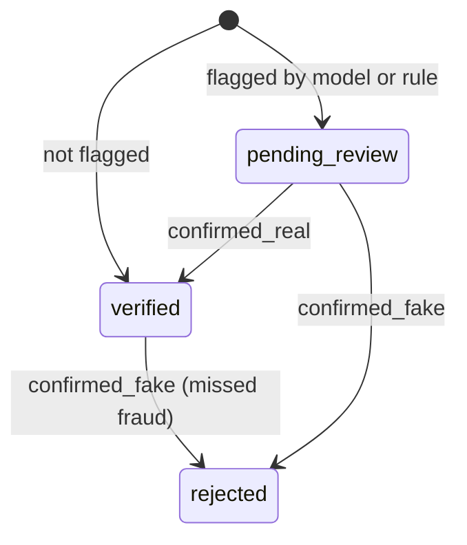

# Reputation and Review

Every customer an agent registers is scored by the fraud model and the
transparent rules (see [ML model service](ml-scoring.md)). Flagged customers
wait for a human review, and the outcome feeds the agent's reputation.

## Who Sees What

| Role | Can see |
| --- | --- |
| Admin | Review queue, every assessment (probability, reasons, features), agent ranking and detail with reputation, scoring settings, model status |
| Agent | Their referral link and the list of customers they onboarded (name, registration date, assisted) |
| Client | Registration quality for the agents assigned to them: registrations, confirmed fake % (decided by a reviewer), the number under review, and a monthly trend |

Agents can see only their referral link and the list of customers they
onboarded. Reputation is an admin-only decision-support tool. A future
commission module may show payout status to agents.

This is a deliberate design decision to stop agents from gaming the system.
A customer's status is not shown to agents either: an unflagged customer is
verified at once while a flagged one waits for review, so the status would
reveal which customers the model flagged.

## Review Workflow



- `GET /admin/review-queue` lists flagged assessments without a review,
  oldest first, with the probability and top three reasons.
- `POST /admin/assessments/{id}/review` records the decision. Each assessment
  can be reviewed once (a second attempt is 409). Any assessment can be
  reviewed, so an admin can also mark fraud the model missed.
- Every review attempt is written to the audit log with the subject
  `assessment:<id>` and the agent as target.

## Reputation

[`backend/app/services/reputation.py`](../backend/app/services/reputation.py):

```text
flags      = customers with status pending_review or rejected
reputation = 100 * (1 - (flags + k * p0) / (n_users + k))   rounded to 1 decimal
risk_score = 100 - reputation
```

- **Flags.** A flagged, unreviewed customer is `pending_review`; a confirmed
  fake is `rejected`. A `confirmed_real` review sets `verified`, which removes
  the flag. Counting statuses is therefore the same as "confirmed fake, or
  flagged and not yet reviewed".
- **Smoothing.** p0 = 0.0539 is the expected flag rate and k = 10 acts as ten
  imaginary customers flagged at that rate, so a new agent starts at 94.6 and
  one flag cannot swing a small agent to an extreme. Example: 200 users with
  11 flags gives 100 x (1 - 11.539 / 210) = 94.5. The formula is the same as
  in `ml/notebooks/06_agent_simulation.ipynb`.
- **Bands.** Fewer than `min_users_for_band` (30) customers gives
  "Insufficient data"; otherwise below 90 is "High risk", below 92 is "Watch",
  and the rest is "Low risk". Admins still see the score for small agents.
- **Always current.** Reputation is calculated when it is read, so it changes
  immediately after a registration, a review, or a settings change.

## Settings

`GET` and `PUT /admin/scoring-config` read and replace p0, k,
min_users_for_band, high_risk_below, watch_below, and device_email_rule_min.
The API validates the same limits as the database CHECK constraints
(0 < p0 < 1, k > 0, min_users_for_band >= 1, 0 <= high_risk_below <=
watch_below <= 100, device_email_rule_min >= 3). Every change is audited.

## Model Reload

`POST /admin/model/reload` loads the model files again and repeats the version
and golden checks. If the new model fails, the current model stays in use and
the endpoint returns 409 with the reason. Both outcomes are audited with the
subject `model_version:<version>`.

## Erasure Requests

Customers can ask for their personal data to be erased (Kenya Data Protection
Act 2019, see the privacy notice on `/join`).

- **Handled by an admin.** In the review dialog, "Erase customer data" opens a
  confirmation that requires typing the customer's email; the API checks it
  again (`POST /admin/customers/{id}/erase`). The customer, their risk
  assessment, and their review are deleted.
- **Audited without personal data.** Every attempt is written to the audit log
  as `customer_erased` with the subject `customer:<id>`, the admin as actor,
  and the agent as target. No name, email, phone number, or date of birth is
  stored in the audit entry.
- **Removed from the agent's reputation.** Reputation is calculated on read,
  so the erased customer no longer counts towards the agent's customers or
  flags. Erasing a confirmed fake therefore raises the agent's reputation; the
  confirmation dialog warns about this, and about customers still waiting for
  review.
- **Retention.** Data needed for fraud prevention or legal claims may be
  retained after case-by-case review under the Kenya Data Protection Act 2019.
  The admin decides whether erasure is appropriate before confirming it.

## KPI Tracking

`backend/app/services/kpis.py` computes monthly KPIs for an agent or the whole
network (SRS 3.8, 8.3). Each month is a cohort: the registrations made in it
(UTC), and what has happened to them so far.

| KPI | Definition |
| --- | --- |
| Registrations | Customers registered in the month |
| Flag rate | Flagged (model or rule) / registrations; admins only |
| Confirmed-fake rate | Confirmed fake / registrations |
| Verification rate | Confirmed real / reviewed |
| Average time to review | Mean of review time minus score time |
| Eligible | Clear or verified registrations |
| Reputation at month end | The reputation formula using only what was known at the end of the month |

A rate is empty ("—") when its denominator is 0, so a quiet month is never
shown as 0 %. For the reputation at time T, a registration counts as a flag
if, before T, an admin confirmed it as fake, or it was flagged and not yet
confirmed real. At the current time this equals the live, status-based
reputation, which a test checks. Two limits: the current p0 and k are used
for every month, because settings changes are not versioned, and erased
customers disappear from earlier months as well.

The admin Overview compares each agent's flag rate over the last 12 months
with the network rate. Agents with fewer than `min_users_for_band`
registrations are listed as "Insufficient data" instead of being compared.
Clients keep the confirmed-outcomes-only rule: their trend shows
registrations, confirmed fakes, and the confirmed-fake percentage, never
flags or confirmed-real counts (which would reveal how many were flagged).

## Commission Eligibility

SalesMesh provides the eligibility input for a commission module (SRS 3.7);
it calculates no amounts and makes no payments.

| Registration status | Eligibility |
| --- | --- |
| clear (not flagged) or verified (confirmed real) | eligible |
| under_review (flagged, no decision yet) or received (not yet scored) | pending |
| rejected (confirmed fake) | not_eligible |

The mapping is in `backend/app/services/eligibility.py` and is derived on read,
so it follows every review at once. Admins see eligibility per customer, per
agent, and per registration month on the **Commission eligibility** page.
Clients see eligible and not-eligible counts per agent for registrations made
for them, but pending only as one total: per agent or per month it would show
which registrations the model flagged, and most flags are genuine customers.

## Agents and Clients

- `PATCH /admin/agents/{id}` changes an agent's display name and assigns or
  removes their client. Each agent works for at most one client.
- `GET /client/quality` counts only customers of the client's agents. Months
  in the trend are calendar months in UTC.
- Clients see only outcomes a person has confirmed, never model flags or scores. At the model's precision about 9 in 10 flagged registrations are genuine, so a "flagged %" would overstate fraud and could unfairly harm an agent's standing with their client.
