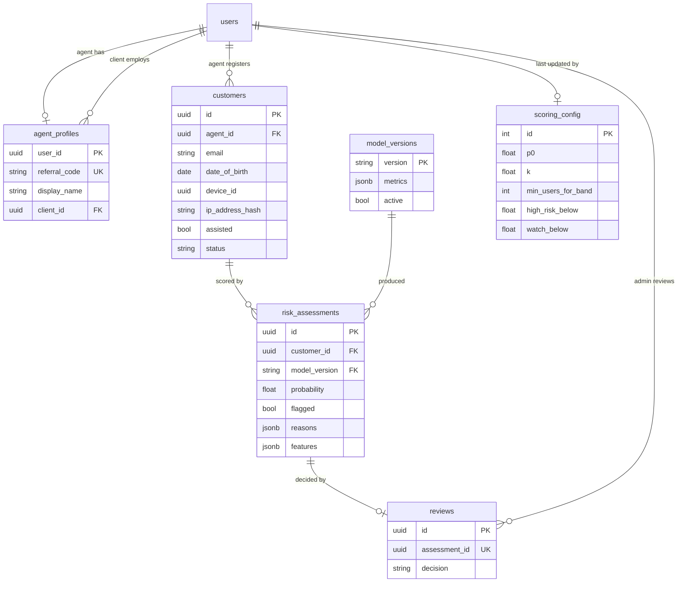

# Scoring Data Model

Migration `0003_add_customer_scoring_tables` adds the tables used to register
customers through agent referral links, score them with the fraud model, and
review flagged registrations. Authentication tables are unchanged apart from a
nullable `audit_logs.subject` column.

## Tables

| Table | Purpose and key rules |
| --- | --- |
| `agent_profiles` | One row per agent. `referral_code` is `AGT-` plus 8 random symbols from an alphabet without 0, O, 1, I, and L (about 8.5 x 10^11 codes). `display_name` is shown on the public join page. `client_id` links the agent to the one client they work for; deleting the client unassigns the agent. |
| `customers` | People registered through a referral link. `email` is not unique, because a repeated email is a fraud signal. `date_of_birth` is stored only for a model feature. The request IP is stored as an HMAC-SHA256 hash, never in raw form. `status` is `pending_review`, `verified`, or `rejected`. |
| `risk_assessments` | One model score: probability, threshold, flag, the top reasons, and a JSON snapshot of the 13 features that produced it. |
| `reviews` | An admin's final decision (`confirmed_real` or `confirmed_fake`). Only one review is allowed per assessment, so the reputation rule always has a single answer. |
| `scoring_config` | The reputation settings. A `CHECK (id = 1)` constraint keeps it to one row, created by the migration with p0 = 0.0539, k = 10, min_users_for_band = 30, high_risk_below = 90, watch_below = 92. |
| `model_versions` | Each loaded model version and its test metrics. A partial unique index allows only one active row. The API records the version at startup after the model passes its checks. |

## Design Decisions

- **Rules in the database.** Allowed statuses and decisions, value ranges, the
  referral code format, and the band order are enforced by CHECK constraints,
  so invalid data is rejected even if application code has a bug.
- **Deletion behaviour.** Deleting a customer cascades to their assessments
  and reviews, which supports data-erasure requests under the Kenya Data
  Protection Act 2019. An agent who has customers cannot be deleted
  (`RESTRICT`), so registration history is never lost by accident.
- **No reputation table.** Agent reputation is calculated when it is read,
  from customers, assessments, reviews, and `scoring_config`, so it can never
  be out of date.
- **Agent profiles.** Agents choose a display name when they register. A user
  whose role is changed to agent gets a profile with the placeholder name
  "SalesMesh agent"; a user who stops being an agent keeps their profile and
  code, so their history stays linked.
- **Audit subject.** `audit_logs.subject` names what a non-user action was
  about, for example `assessment:<uuid>` or `model_version:v1`.
